# Báo cáo đóng góp cá nhân – Dự án SafeAnes

Phạm Tuấn Anh – 2A202601070 · 22/10/2026

## Tổng quan

Em phụ trách phần kỹ thuật của dự án SafeAnes từ tuần 2 đến tuần 6, từ dữ liệu thô tới mô hình và demo. **Kết quả chốt đến ngày 22/10/2026 là LightGBM với 71 đặc trưng**, huấn luyện trên 2.393 ca train. AUROC validation đạt **0,888 / 0,848 / 0,827 / 0,818 / 0,805** ở mốc dự báo 5 / 10 / 15 / 20 / 30 phút. Ngưỡng MAP thông thường trên cùng validation đạt 0,807 ở 5 phút và 0,723 ở 15 phút.

Bộ 71 giảm 79,7% số đặc trưng so với mô hình đầy đủ trước đó dùng 349 đặc trưng. Bốn mô hình đã được huấn luyện lại trên bộ này; LightGBM có AUROC cao nhất ở cả năm mốc theo ước lượng điểm. Trạm theo dõi mô phỏng đã chạy cả bốn mô hình trên 50 ca phát lại và được triển khai trên Azure. Checkpoint, code hỗ trợ và metadata đã được đưa lên [SafeAnesUC04_models](https://huggingface.co/tuananhpham-vnu/SafeAnesUC04_models).

| | |
|---|---|
| Sinh viên | Phạm Tuấn Anh – 2A202601070 |
| Dự án | SafeAnes – cảnh báo sớm tụt huyết áp trong mổ, dự báo trước 5–30 phút |
| Định nghĩa tụt huyết áp | MAP < 65 mmHg kéo dài ít nhất 60 giây |
| Dữ liệu | VitalDB: 6.388 ca mổ, dùng 3.363 ca có huyết áp động mạch |
| Thành viên | Phạm Tuấn Anh, Nguyễn Minh Đạt |
| Phần phụ trách | Đọc tài liệu, proposal, EDA, xử lý dữ liệu, huấn luyện và đánh giá mô hình, ablation, demo web, báo cáo tuần |

Sơ đồ dưới đây cho thấy các phần em phụ trách theo thứ tự dữ liệu đi qua hệ thống. Mỗi khối ghi tuần thực hiện, chi tiết nằm ở chương cùng số.

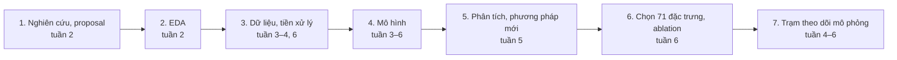

| Tuần | Thời gian | Việc chính | Kết quả nổi bật |
|---|---|---|---|
| 2 | 17–27/09 | Đọc nghiên cứu, EDA, viết proposal | Chỉ riêng MAP đạt AUROC 0,873; cả 173 đặc trưng chỉ lên 0,881 |
| 3 | 28/09–04/10 | Xử lý dữ liệu, huấn luyện 5 mô hình | DL đọc sóng động mạch đạt 0,873, ngang LightGBM (0,874) |
| 4 | 05–11/10 | Thêm dữ liệu trước rạch da, huấn luyện lại, thêm CatBoost, TabM, ngữ cảnh | Số đợt tụt tăng 52%; ngữ cảnh nâng AUROC 15 phút từ 0,793 lên 0,822 |
| 5 | 12–18/10 | Thử 5 hướng mới, hoàn thiện demo | Chỉ-MAP đạt AUROC 0,815 ở 15 phút; thông tin bổ sung chủ yếu là thay đổi thuốc mê |
| 6 | 19–25/10, cập nhật đến 22/10 | Chọn 71 đặc trưng, train lại bốn mô hình trên Kaggle, kiểm tra và triển khai trạm theo dõi | LightGBM 71 đạt AUROC 0,888 / 0,827 ở 5 / 15 phút; giảm 79,7% số đặc trưng so với bộ 349 |

**Cách đọc số liệu.** Trừ khi ghi khác, AUROC được tính trên validation 248 ca, tại mọi thời điểm đủ điều kiện dự đoán (30 giây một lần). Train có 2.393 ca, các tập chia theo bệnh nhân. "Mốc 15 phút" nghĩa là dự báo có tụt huyết áp trong 15 phút tới hay không. Khoảng tin cậy 95% tính bằng bootstrap theo bệnh nhân.

**Giới hạn đánh giá.** Ablation dùng CV trên 258 ca calibration; điểm dừng 71 được chọn sau khi xem validation. Các mô hình cuối fit trên train, hiệu chỉnh Platt trên calibration và chọn ngưỡng trên validation. Validation vì vậy đã tham gia lựa chọn, không phải tập đánh giá độc lập sau khi khóa cấu hình. Test 464 ca đã được dùng ba lần để xác nhận các mô hình trước; kết quả test hiện tại chỉ để mô tả và phát lại demo.

---

## 1. Nghiên cứu và proposal (tuần 2)

Chương này đặt nền cho cả dự án: chọn bài toán, chọn cách đánh giá và chọn hướng mô hình. Em đọc khoảng 15 bài và ghi lại điều áp dụng được cho dự án. Bảng dưới là các bài ảnh hưởng nhiều nhất.

| Bài | Nội dung chính | Áp dụng vào dự án |
|---|---|---|
| Lee HC 2022, *Scientific Data* | Bộ VitalDB: 6.388 ca, có sóng và sinh hiệu | Nguồn dữ liệu; nhóm các ca theo bệnh nhân |
| Hatib 2018, *Anesthesiology* (HPI) | Đặc trưng sóng động mạch, AUROC 0,97 ở mốc 5 phút | Thử đặc trưng sóng; cài lại cách chọn mẫu để so sánh |
| Mulder 2024, *Anesthesiology* | HPI không tốt hơn một ngưỡng MAP | Luôn so với baseline ngưỡng MAP |
| Yang 2025, *BJA* | Chọn mẫu thiên lệch làm PPV giảm từ 0,937 xuống 0,068 | Đánh giá ở mọi thời điểm, không chọn mẫu |
| Lee S 2021, *BJA* | CNN đọc sóng động mạch | Thử DL đọc sóng thô |
| Zhu 2026, Wang 2026 | Transformer và Conv1D + Transformer trên VitalDB | Chọn kiến trúc Conv1D + Transformer |
| Kouz 2023, Jian 2025 | Nhóm nguyên nhân tụt: giãn mạch, thiếu dịch, nhịp chậm | Phân tách HR × SV × SVR để giải thích cảnh báo |
| TabM, ICLR 2025 | MLP gồm nhiều mô hình con cho dữ liệu bảng | Thêm TabM vào phần so sánh |

Bài học lớn nhất từ tài liệu là cách đánh giá quan trọng ngang mô hình. Nhiều bài báo cáo AUROC trên 0,95 nhưng chỉ lấy mẫu ở những đoạn dễ phân biệt. Yang (2025) cho thấy khi đánh giá trên dữ liệu ít chọn lọc hơn, PPV giảm từ 0,937 xuống 0,068. Vì vậy dự án chọn đánh giá ở mọi thời điểm và luôn đặt cạnh ngưỡng MAP.

Từ đó em viết proposal HemoDecomp. Proposal có bốn nhánh. Nhánh chính dự báo nguy cơ tụt trong 1–15 phút. Ba nhánh còn lại phân rã MAP ≈ SV × HR × SVR để giải thích, gợi ý nguyên nhân bằng nhãn yếu, và ước lượng độ tin cậy. Kèm theo là kế hoạch nghiên cứu và cách dùng GPU Kaggle T4.

Em cũng chạy một pilot nhỏ trên 300 ca để kiểm tra bài toán trước khi làm lớn. Pilot so sánh 14 cách, gồm hồi quy logistic theo MAP, LightGBM, CatBoost, TabM và ensemble. Ở mốc 10 phút, hồi quy logistic chỉ dùng MAP đứng đầu trên cả hai tập, bắt được 22/24 đợt tụt. Kết quả này khớp với Mulder (2024) và báo trước điều các tuần sau xác nhận lại: mô hình phức tạp không tự động tốt hơn.

*Minh chứng: `UC04_RESEARCH_PLAN.md`, `docs/SOURCES.md`, `docs/UC04_METHOD_PROPOSAL.md`, `reports/E08/METHOD_COMPARISON.md`.*

---

## 2. EDA dữ liệu (tuần 2)

EDA cho thấy dữ liệu đủ để làm bài toán, nhưng nhãn có hai lỗ hổng cần sửa. Em tải 116.123 file track của 3.626 ca đủ điều kiện và phân tích nhiễu, nhãn, diễn biến trước đợt tụt.

| Chỉ số | Giá trị |
|---|--:|
| Ca có ít nhất một đợt tụt | 50,9% |
| Tổng số đợt tụt | 5.306 |
| Thời lượng một đợt (trung vị) | 186 giây |
| Tỷ lệ thời điểm có tụt trong 5 phút tới | 3,1% |
| Đợt tụt có MAP thấp nhất ≤ 30 mmHg | 4,9% |
| Đợt tụt khởi phát trong 30 phút đầu sau gây mê | 0,6% |

Nhãn rất mất cân bằng, nên độ chính xác (accuracy) không có ý nghĩa. Chỉ 3,1% thời điểm có tụt huyết áp trong 5 phút tới. Một mô hình luôn đoán "không tụt" đã đúng 96,9%. Vì vậy dự án dùng AUROC, AUPRC, độ nhạy theo đợt tụt và số cảnh báo sai mỗi giờ.

Lỗ hổng thứ nhất là nhãn bỏ sót giai đoạn khởi mê. Protocol cũ chỉ gán nhãn từ lúc rạch da, nên chỉ 0,6% đợt tụt nằm trong 30 phút đầu. Trong khi đó, khởi mê là lúc thuốc mê gây giãn mạch mạnh nhất. Phát hiện này dẫn tới việc mở rộng dữ liệu ở tuần 4. Lỗ hổng thứ hai là nhiễu đường động mạch. Có 4,9% đợt tụt với MAP thấp nhất dưới 30 mmHg, nhiều khả năng do flush hoặc lấy máu chứ không phải tụt thật.

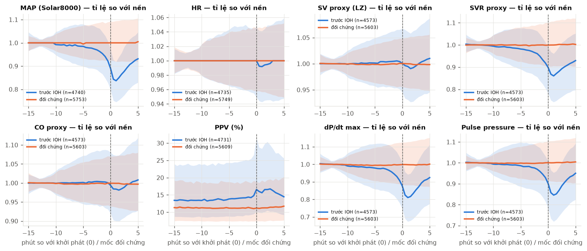

*Diễn biến trong 15 phút trước đợt tụt (xanh) so với nhóm đối chứng (cam), tính theo tỷ lệ so với giá trị nền của chính ca.*

Trước đợt tụt, MAP không rơi đột ngột mà giảm dần từ khoảng 8 phút trước. SVR và dP/dt ước lượng từ sóng giảm cùng hình dạng, còn SV và nhịp tim gần như phẳng. Điều này gợi ý giãn mạch là cơ chế hay gặp nhất. Sự sụt tăng tốc trong 2–3 phút cuối, nên báo trước được nhiều phút là việc khó.

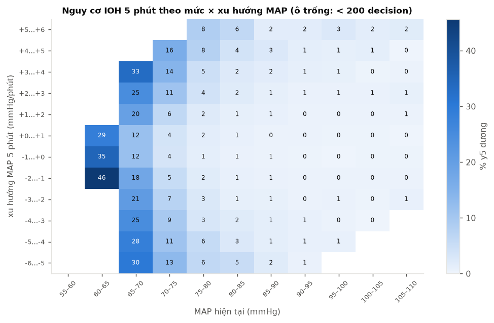

*Tỷ lệ có tụt trong 5 phút tới theo MAP hiện tại (trục ngang) và xu hướng MAP (trục dọc).*

Mức MAP hiện tại quyết định nguy cơ nhiều hơn xu hướng. Với MAP 60–65 mmHg, nguy cơ là 29–46% bất kể MAP đang lên hay xuống. Trên 90 mmHg, nguy cơ gần 0 dù MAP đang giảm. Xu hướng chỉ có ích ở vùng giữa, khoảng 70–85 mmHg. Tương ứng, mô hình chỉ dùng 20 đặc trưng MAP đạt AUROC 0,873, còn dùng cả 173 đặc trưng chỉ lên 0,881. Giới hạn của bài toán vì thế không nằm ở số tín hiệu, mà ở chất lượng nhãn và cách đặt cảnh báo.

*Minh chứng: `reports/EDA/REPORT.md`, `reports/EDA/INSIGHTS.md`, `src/safeanes/eda/`.*

---

## 3. Dữ liệu và tiền xử lý (tuần 3, 4, 6)

Em xây pipeline biến dữ liệu thô của VitalDB thành các mẫu dự đoán, rồi mở rộng nó qua ba phiên bản. Mỗi phiên bản sửa một vấn đề mà EDA hoặc mô hình chỉ ra.

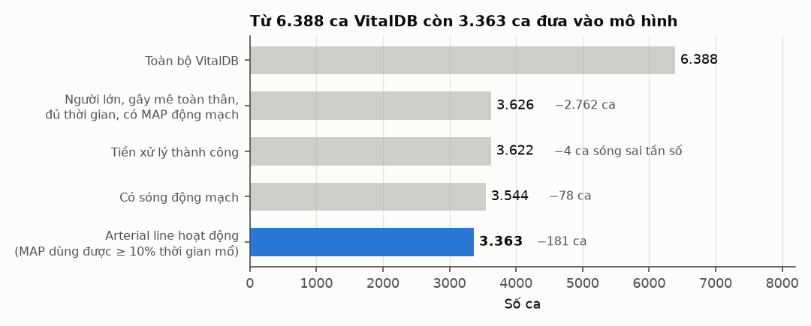

Bước lọc lớn nhất là bỏ các ca không có MAP động mạch, vì nhãn dựa vào huyết áp xâm lấn. EDA đã cho thấy NIBP không thay được ART: ở 55,6% thời điểm ART dưới 65 mmHg, NIBP vẫn trên 65 mmHg. Bước cuối loại 181 ca có đường động mạch đặt nhưng gần như không dùng được.

| Tín hiệu | Cách xử lý |
|---|---|
| Chỉ số monitor (MAP, HR, SpO₂, EtCO₂…) | Đưa về lưới 2 giây, lấy giá trị gần nhất (cũ tối đa 30 giây), đánh dấu nhiễu |
| Sóng động mạch 500 Hz | Tách từng nhịp, loại nhịp lỗi, đánh dấu flush và sóng phẳng, hạ xuống 100 Hz cho DL |
| MAP để gán nhãn | Lưới 1 giây đã làm sạch; chỉ dùng để gán nhãn, không làm đầu vào |

Mô hình đưa ra dự đoán 30 giây một lần, cho 5 mốc: 5, 10, 15, 20 và 30 phút. Mọi đặc trưng tại thời điểm t chỉ dùng dữ liệu trước t. Các thời điểm đang tụt, trong 2 phút sau đợt tụt hoặc thiếu MAP bị bỏ. Các tập chia theo bệnh nhân, nên một người mổ nhiều lần vẫn chỉ nằm ở một tập.

| Tập | Số ca | Bệnh nhân | Mục đích |
|---|--:|--:|---|
| Train | 2.393 | 2.302 | Huấn luyện |
| Calibration | 258 | 244 | Hiệu chỉnh xác suất |
| Validation | 248 | 245 | Chọn ngưỡng, báo cáo; đã tham gia chọn điểm dừng 71 đặc trưng |
| Test | 464 | – | Đã dùng trước; hiện chỉ đánh giá mô tả và phát lại demo |

Phiên bản v3 ở tuần 4 thêm giai đoạn từ khởi mê tới rạch da. Mỗi ca có thêm trung vị 41,5 phút dữ liệu. Giai đoạn này chỉ chiếm 15% số giờ nhưng chứa 37% số đợt tụt, đúng như EDA dự đoán.

| | v2 (tuần 3) | v3 (tuần 4) | Thay đổi |
|---|--:|--:|--:|
| Số giờ đánh giá | 6.214 | 7.147 | +15% |
| Mốc dự đoán | 747.762 | 859.706 | +15% |
| Đợt tụt huyết áp | 4.922 | 7.474 | +52% |

Các bộ đầu vào được khảo sát qua các tuần để tìm thông tin bổ sung rồi bỏ phần lặp. Các bộ 214 và 228 là những nhánh thử nghiệm trước; **bộ cuối 71 được chọn trực tiếp bằng RFE từ bộ 349**, không phải rút tiếp từ bộ 214. Chi tiết nằm ở chương 6.

| Tuần | Số đặc trưng | Thay đổi |
|---|--:|---|
| 3 | 66 (+27 đặc trưng sóng) | Thống kê 9 tín hiệu monitor trong cửa sổ W, MAP so với nền, MAP ngoại suy |
| 4 | 97 | Thêm 31 đặc trưng ngữ cảnh: xu hướng 5–30 phút, thời gian từ khởi mê và rạch da, lịch sử đợt tụt |
| 4 | 349 | Thêm thuốc mê, BIS, thở máy, xét nghiệm, thông tin trước mổ |
| 5 | 228 | Thêm 14 đặc trưng ECG/PPG tự trích từ sóng 500 Hz cho 2.898 ca |
| 6 | 214, bộ tham chiếu | Khảo sát bộ không thêm ECG/PPG và tổ hợp sinh lý |
| 6 | **71, bộ đã chốt** | RFE từ bộ 349; train lại bốn mô hình và dùng trong trạm theo dõi |

*Minh chứng: `scripts/data/` (`preprocess_vitaldb.py`, `extract_beats.py`, `build_features.py`, `extract_ecg_ppg.py`), `src/uc04/`, `configs/uc04_v3.json`.*

---

## 4. Mô hình (tuần 3–4, cập nhật ở tuần 5–6)

### Kết quả đã chốt trên bộ 71 đặc trưng

Bốn họ mô hình dùng cùng 71 cột của `features_v8`, cửa sổ W = 120 giây và train 2.393 ca. Log TabM ghi nhận 810.559 dòng eligible có ít nhất một nhãn đã biết; loss bỏ qua nhãn chưa biết ở từng mốc. LightGBM, CatBoost và logistic fit trên các dòng train eligible có nhãn 0 hoặc 1 của mốc tương ứng. Calibration không dùng để fit trọng số mô hình cuối. Mọi bước huấn luyện và kiểm tra mô hình thực hiện trên Kaggle.

| AUROC validation | 5 phút | 10 phút | 15 phút | 20 phút | 30 phút |
|---|--:|--:|--:|--:|--:|
| **LightGBM, 71** | **0,888** [0,872; 0,902] | **0,848** | **0,827** | **0,818** | **0,805** |
| CatBoost, 71 | 0,884 | 0,845 | 0,825 | 0,814 | 0,802 |
| TabM, 71 | 0,883 | 0,845 | 0,823 | 0,811 | 0,798 |
| Hồi quy logistic, 71 | 0,864 | 0,827 | 0,810 | 0,801 | 0,791 |

**LightGBM được chọn làm mô hình chính.** CatBoost và TabM thấp hơn khoảng 0,002–0,007 AUROC, logistic thấp hơn 0,014–0,024. Đây là thứ hạng theo ước lượng điểm; chưa kết luận mọi chênh lệch đều có ý nghĩa thống kê.

Ngưỡng cảnh báo được chọn riêng cho từng mô hình trên validation, với ngân sách khoảng một cảnh báo sai mỗi giờ. Luật cảnh báo dùng hai mốc liên tiếp vượt ngưỡng, nghỉ 5 phút và chỉ báo lại sau khi nguy cơ xuống dưới ngưỡng.

| Validation, mốc 5 phút | Độ nhạy theo đợt | Cảnh báo sai / giờ | PPV cảnh báo | Báo trước, trung vị |
|---|--:|--:|--:|--:|
| LightGBM, 71 | 0,605 | 0,997 | 0,345 | 110 giây |
| CatBoost, 71 | 0,580 | 0,944 | 0,347 | 103 giây |
| TabM, 71 | 0,548 | 0,964 | 0,330 | 116 giây |
| Hồi quy logistic, 71 | 0,493 | 0,954 | 0,309 | 108 giây |

Ở mốc 15 phút, LightGBM đạt độ nhạy 0,633, khoảng 0,999 cảnh báo sai mỗi giờ và báo trước trung vị 283 giây (4,7 phút). Ngân sách báo sai thực tế khác nhau giữa các mô hình nên cần đọc độ nhạy cùng số cảnh báo sai.

**Test chỉ để mô tả:** AUROC 5 phút của LightGBM, CatBoost, TabM và logistic lần lượt là 0,900 / 0,897 / 0,890 / 0,875. LightGBM đạt độ nhạy khoảng 0,63 với 0,97 cảnh báo sai mỗi giờ. Các kết quả này không dùng để chọn cấu hình hoặc xác nhận ưu thế của mô hình.

### Các kết quả trong quá trình phát triển

Các thử nghiệm trước cho thấy bổ sung lịch sử MAP và thông tin thuốc mê có ích hơn nhiều thay đổi thuật toán. Bảng sau ghi lại quá trình phát triển; các bộ 97, 214 và 228 không phải bộ đầu vào chốt cuối.

| Tuần | Dữ liệu, đầu vào | Mô hình tốt nhất | AUROC 5 phút | AUROC 15 phút | Thay đổi chính |
|---|---|---|--:|--:|---|
| 2 | Pilot 300 ca, 140 đặc trưng | Hồi quy logistic theo MAP | – | – | AUROC 10 phút 0,881; ở mốc 5 phút các cách không phân biệt được |
| 3 | v2, 66 + 27 sóng | LightGBM | 0,874 | 0,790 | DL đọc sóng thô không hơn LightGBM |
| 4 | v3, 97 | LightGBM + ngữ cảnh | 0,885 | 0,822 | Ngữ cảnh +0,029 ở mốc 15 phút |
| 5 | v3, 228 | LightGBM | 0,890 | 0,832 | Thêm thuốc mê, thở máy, lâm sàng, ECG/PPG |
| 6, tham chiếu | v3, 214 | LightGBM | 0,890 | 0,830 | Bộ khảo sát trước khi chốt 71 |
| **6, đã chốt** | **features_v8, 71** | **LightGBM** | **0,888** | **0,827** | **Train lại trên 2.393 ca, dùng trong demo hiện tại** |

*Số liệu tuần 2 tính trên 24 ca validation của pilot, tuần 3 trên dữ liệu v2 (chỉ trong mổ). Vì dữ liệu khác nhau, hai dòng này không so trực tiếp được với các dòng sau. Các dòng từ tuần 4 cùng dữ liệu v3 và cùng 248 ca validation.*

Trong giai đoạn trước, em so sánh các mô hình trên thống kê monitor, đặc trưng sóng và các bản thêm ngữ cảnh. DL Conv1D + Transformer đọc trực tiếp sóng động mạch 100 Hz cùng 66 chỉ số monitor. DL được khảo sát với bốn cửa sổ W × năm seed trên Kaggle GPU T4, mỗi seed mất 35–100 phút. Đây là các thử nghiệm trước khi chốt bộ 71.

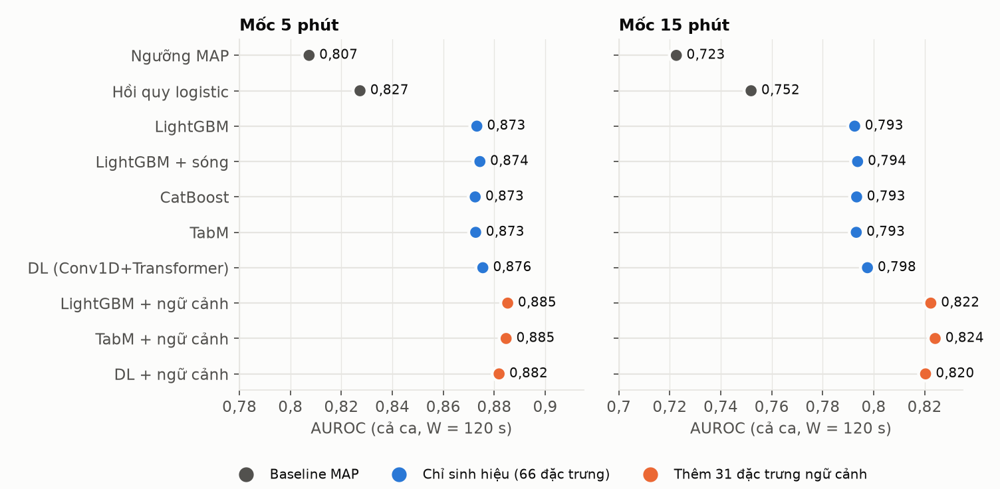

*AUROC của các mô hình trên dữ liệu v3, W = 120 giây.*

Trong nhóm cấu hình chưa thêm ngữ cảnh của thử nghiệm này, AUROC ở mốc 5 phút nằm trong khoảng 0,873–0,876, ở mốc 15 phút trong khoảng 0,793–0,798. DL chỉ nhỉnh hơn khoảng 0,003 nhưng tốn hàng giờ GPU, trong khi một cấu hình LightGBM train trong khoảng 20 giây. Kết quả đó là cơ sở tiếp tục ưu tiên cải thiện đầu vào; bảng bốn mô hình 71 ở trên là kết quả cập nhật cuối.

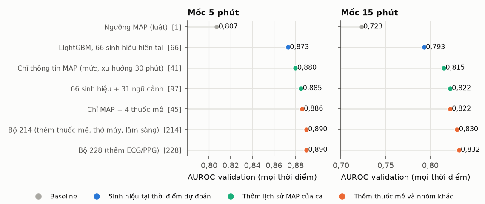

*AUROC của các bộ đầu vào đã khảo sát trước khi chốt 71, cùng dữ liệu v3 và validation. Số trong ngoặc là số đặc trưng.*

Lịch sử MAP của ca giúp nhiều hơn mọi tín hiệu khác. Mô hình chỉ dùng 41 đặc trưng về MAP, gồm mức hiện tại, mức thấp nhất trong 5–30 phút và các đợt tụt trước, đạt 0,815 ở mốc 15 phút. Con số này cao hơn mô hình 66 sinh hiệu chỉ nhìn 2 phút gần nhất (0,793). Thêm thuốc mê và các nhóm còn lại chỉ tăng thêm 0,015–0,017. Điều này giải thích vì sao ngữ cảnh ở tuần 4 là bước tiến lớn nhất. Cửa sổ W dài cũng chỉ có ích cho mô hình không có ngữ cảnh. Khi đã có xu hướng 30 phút, tăng W từ 30 lên 120 giây gần như không đổi AUROC.

Mọi mô hình đều dự báo kém hơn ở giai đoạn trước rạch da. Ở mốc 5 phút, AUROC trước rạch da chỉ 0,817–0,823, trong mổ là 0,873–0,875. Cùng một mức MAP, nguy cơ tụt trước rạch da cao hơn trong mổ từ 1,4 đến 7,6 lần, vì tác dụng của thuốc mê liều đầu chưa thể hiện ngay trên MAP. DL cũng không có lợi thế ở giai đoạn này, vì sóng động mạch chỉ có từ lúc rạch da.

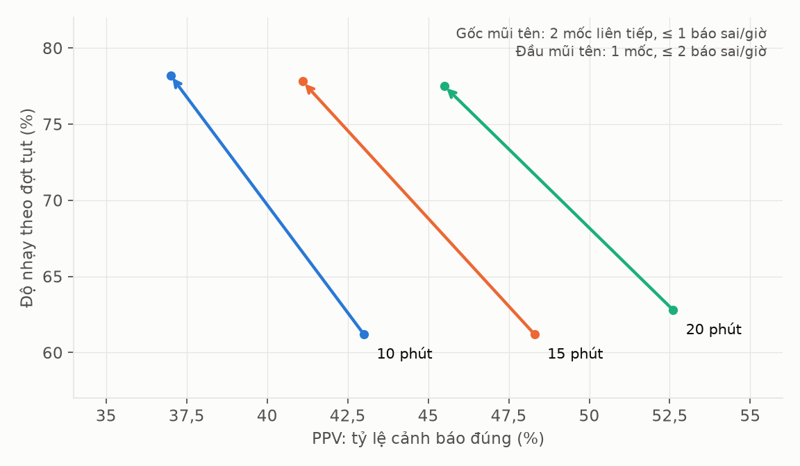

*Độ nhạy và PPV khi đổi quy tắc cảnh báo, mô hình 349 đặc trưng.*

Ở mức cảnh báo, quy tắc cảnh báo ảnh hưởng tới độ nhạy nhiều hơn chính mô hình. Với quy tắc "2 mốc liên tiếp, tối đa 1 cảnh báo sai mỗi giờ", độ nhạy ở mốc 15 phút là 61,2%. Đổi sang "1 mốc, tối đa 2 cảnh báo sai mỗi giờ", độ nhạy lên 77,8% và PPV giảm từ 48,3% xuống 41,1%. Mức thay đổi 16 điểm này lớn hơn nhiều so với khác biệt giữa các thuật toán, vốn dưới 3 điểm. Đây là lựa chọn cần thống nhất với bác sĩ, vì nó đổi giữa bắt nhiều đợt tụt và báo sai nhiều hơn. Bảng này tính trên tập lớn hơn (6.559 đợt tụt), nên không so từng con số với các bảng khác.

*Minh chứng: `scripts/train_tabular.py`, `scripts/train_tabm.py`, `scripts/train_dl.py`, `notebooks/kaggle/03_dl_*`, `reports/weekly/week12.md`, `reports/weekly/week13.md`.*

---

## 5. Phân tích và phương pháp mới (tuần 5)

Tuần 5 em thử năm hướng mới để trả lời câu hỏi "ngoài MAP, còn gì giúp được mô hình và bác sĩ". Mỗi hướng có một câu hỏi rõ và một quyết định sau khi có kết quả.

| Hướng | Câu hỏi | Kết quả | Quyết định |
|---|---|---|---|
| Thông tin ngoài MAP | Khi đã biết MAP, đặc trưng nào còn thêm được thông tin? | Trong 217 đặc trưng, chỉ 13–19 còn ý nghĩa, phần lớn là thay đổi thuốc mê | Giữ nhóm thuốc mê |
| ECG và PPG | Biến thiên nhịp tim, thời gian truyền sóng mạch có giúp không? | AUROC chỉ tăng 0,001–0,002 | Không giữ |
| Truy nguyên cảnh báo | Cảnh báo do giãn mạch, giảm thể tích nhát bóp hay nhịp chậm? | Cảnh báo đúng và sai có cùng mẫu hình sinh lý | Dùng để giải thích, không dùng để lọc cảnh báo |
| Cá nhân hoá | Ngưỡng, nhãn hay đặc trưng riêng cho từng bệnh nhân có giúp không? | Ngưỡng theo hồ sơ nguy cơ giảm được cảnh báo sai trong thử nghiệm cũ | Cần đánh giá lại trên mô hình 71 |
| Lớp LLM | Viết giải thích cảnh báo cho bác sĩ gây mê | Đã có prompt và thẻ bằng chứng, chưa gọi LLM thật | Chờ API key |

Phần lớn đặc trưng chỉ liên quan tới tụt huyết áp vì chúng phản ánh lại MAP. Khoảng 180/217 đặc trưng có ý nghĩa khi đứng riêng. Khi đã biết MAP, chỉ còn 13–19. Nhóm còn lại hầu hết là thay đổi thuốc mê, như Ce remifentanil, propofol và MAC thay đổi trong 1–10 phút. Các đặc trưng này gần như ngẫu nhiên khi đứng riêng (AUROC 0,50–0,54), nhưng lại thêm được nhiều nhất. Lý do là thuốc mê không cho biết MAP đang ở đâu, mà cho biết MAP sắp đi về đâu.

ECG và PPG thêm được rất ít khi đã có MAP. Em tự trích 14 đặc trưng từ sóng ECG và PLETH 500 Hz cho 2.898 ca, gồm biến thiên nhịp tim, thời gian truyền sóng mạch và biên độ PPG. Thêm cả 14 đặc trưng chỉ tăng AUROC 0,001–0,002. Kết quả này khớp với Lee (2021): mô hình nhiều kênh chỉ hơn mô hình một kênh sóng động mạch 0,006.

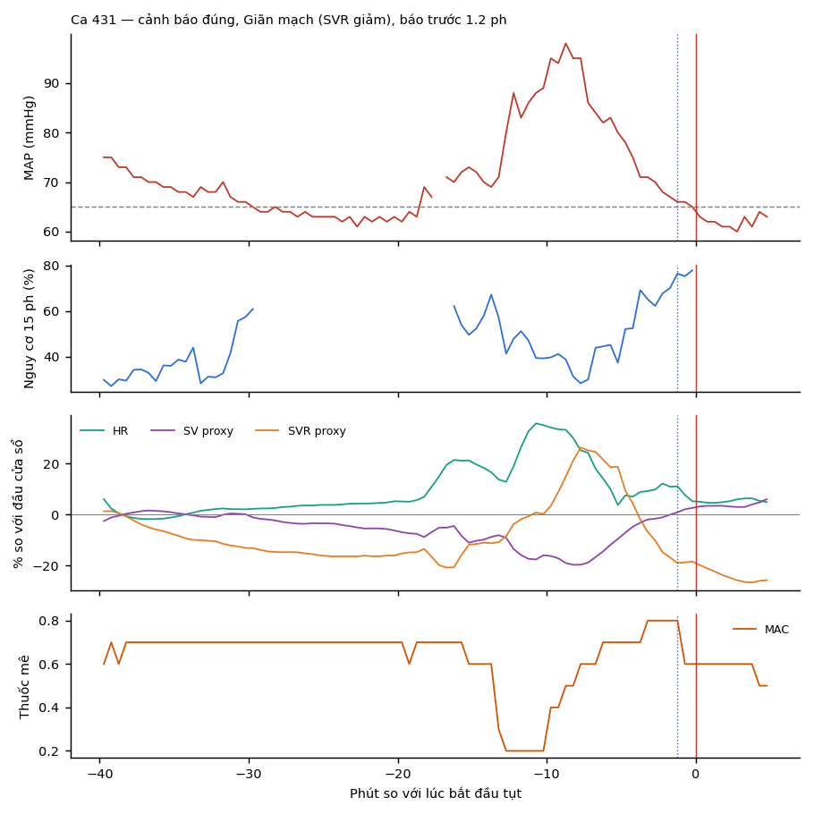

*Ca 431: MAP giảm 17% trong 10 phút, trong đó SVR giảm 18%, sau khi MAC tăng từ 0,6 lên 0,8. Cảnh báo phát ra 1,2 phút trước đợt tụt.*

Truy nguyên giúp giải thích vì sao MAP giảm, nhưng không giúp phân biệt cảnh báo đúng với sai. Em tách thay đổi MAP trong 10 phút thành thay đổi HR, SV và SVR, rồi gán vào một mẫu hình. Giãn mạch là mẫu hay gặp nhất trước đợt tụt (27–31%), nhưng cũng gặp ở 28% cảnh báo sai. Nguyên nhân là mô hình gần như chỉ dựa vào MAP thấp hoặc đang giảm. Thẻ giải thích vì vậy có ích cho bác sĩ, nhưng không thay được việc chọn ngưỡng.

| Cách cá nhân hoá | ΔAUROC 15 phút | ΔCảnh báo sai/giờ | Nhận xét |
|---|--:|--:|---|
| Đặc trưng sinh lý riêng trong ca | +0,000 | +0,01 | Mô hình đã có lịch sử MAP của ca |
| Hồ sơ trước mổ cộng vào logit | −0,006 | +0,02 | Làm mô hình kém đi |
| **Ngưỡng theo hồ sơ nguy cơ** | 0 | **−0,05 đến −0,08** | Giảm báo sai, độ nhạy giảm dưới 1 điểm |
| Nhãn riêng theo MAP nền | – | – | Đổi bài toán, cần thống nhất với bác sĩ |

*Δ so với mô hình tuần 4, bootstrap ghép cặp theo bệnh nhân.*

*Các kết quả cá nhân hoá này chưa được xác nhận lại trên LightGBM 71. Bản demo hiện tại dùng ngưỡng đã chọn cho từng mô hình và mốc dự báo.*

Trong bốn cách cá nhân hoá, chỉ chọn ngưỡng riêng cho nhóm nguy cơ cao là có ích. Nhóm này gồm người từ 70 tuổi, ASA ≥ 3, tăng huyết áp, đái tháo đường hoặc mổ cấp cứu. Với ngưỡng riêng, cảnh báo sai giảm từ 0,92 xuống 0,84 mỗi giờ ở mốc 5 phút, PPV tăng 1–2 điểm. Nhãn riêng theo MAP nền thay đổi bài toán nhiều nhất: ngưỡng của 84% bệnh nhân lên trên 65 mmHg, số đợt tụt tăng từ 0,87 lên 1,42 đợt mỗi giờ.

Em cũng cài lại cách chọn mẫu của Hatib (2018) và Lee (2021) để so sánh với các nghiên cứu khác. Hai cách này bỏ các mẫu âm khó, tức là các lúc MAP thấp nhưng không tụt.

| Mô hình | Hatib, 5 / 15 phút | Lee, 15 phút | Mọi thời điểm, 5 / 15 phút |
|---|--:|--:|--:|
| HPI (Hatib 2018) | 0,97 / 0,95 | – | – |
| CNN sóng động mạch (Lee 2021) | – | 0,891 | – |
| Ngưỡng MAP | 0,920 / 0,906 | 0,817 | 0,807 / 0,723 |
| Chỉ thông tin MAP (41 đặc trưng) | 0,984 / 0,976 | 0,898 | 0,880 / 0,815 |
| Mô hình tuần 4 (97 đặc trưng) | 0,986 / 0,979 | 0,904 | 0,885 / 0,822 |

Theo cách chọn mẫu của Hatib, mô hình chỉ dùng MAP đã vượt HPI. Ngay cả ngưỡng MAP cũng tăng từ 0,807 lên 0,920. Như vậy con số AUROC trên 0,95 phần lớn đến từ cách chọn mẫu, không phải từ mô hình. Dự án vẫn dùng cách đánh giá ở mọi thời điểm làm kết quả chính.

*Minh chứng: `src/uc04/` (`beyond_map`, `ecg_ppg`, `mechanism`, `hemo_forecast`, `rel_labels`, `llm_explain`, `peer_protocols`), `scripts/personalize.py`, `reports/weekly/week14.md`.*

---

## 6. Giảm chiều đặc trưng và ablation (tuần 6)

**Bộ đã chọn là 71 đặc trưng**, giảm 278 đặc trưng (79,7%) so với bộ đầy đủ 349 của `lgbm_full_v4`. Chương này trình bày phân tích trùng lặp và ablation dẫn tới lựa chọn đó. Các mô hình ablation đều fit trên 258 ca calibration rồi đánh giá trên validation; chúng khác với bốn mô hình cuối fit trên 2.393 ca train ở chương 4.

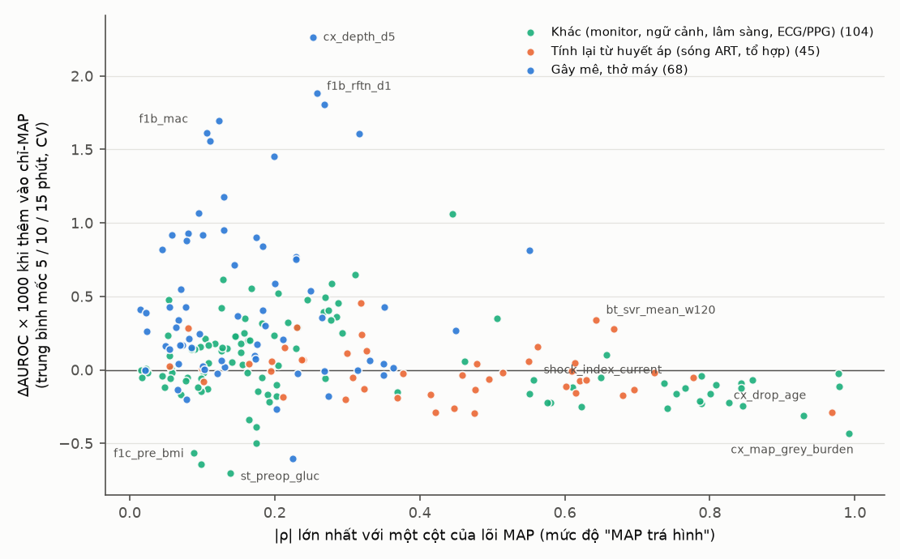

*Trục ngang: mức tương quan lớn nhất với lõi MAP. Trục dọc: AUROC tăng thêm khi thêm đặc trưng vào mô hình chỉ dùng MAP.*

Đặc trưng càng giống MAP thì càng ít thêm được thông tin. Các đặc trưng tính lại từ huyết áp (cam) nằm bên phải và quanh trục 0, tức là chỉ lặp lại MAP. Các đặc trưng gây mê (xanh) nằm bên trái nhưng cao nhất, vì chúng mang thông tin khác MAP. Ví dụ, SVR ước lượng có AUROC đứng riêng 0,687 nhưng chỉ thêm 0,0001, còn MAC đứng riêng chỉ 0,529 nhưng thêm 0,0017.

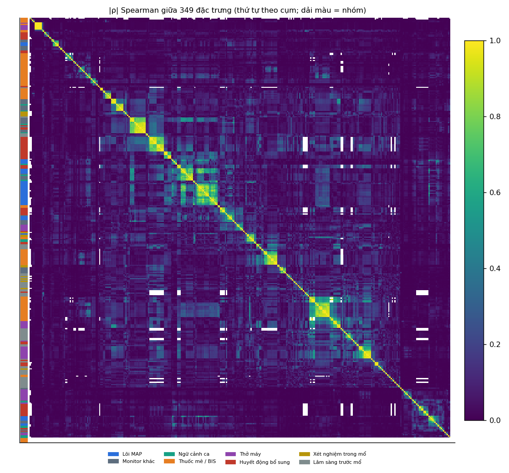

*Tương quan giữa 349 đặc trưng, sắp theo cụm; dải màu bên trái là nhóm.*

Trùng lặp nhiều nhưng chủ yếu nằm trong cùng một nhóm. Có 91 cặp tương quan |ρ| ≥ 0,95, đa số là cùng một tín hiệu tính ở cửa sổ khác nhau, như trung bình 2 phút và 15 phút. Em bỏ dần các đặc trưng trùng theo nhiều ngưỡng tương quan rồi đánh giá lại.

| Bỏ trùng ở mức | Còn lại | ΔAUROC validation 5 / 10 / 15 phút |
|---|--:|--:|
| \|ρ\| ≥ 0,95 | 298 | +0,000 / +0,000 / +0,001 |
| \|ρ\| ≥ 0,90 | 272 | −0,001 / +0,002 / −0,000 |
| **\|ρ\| ≥ 0,85** | **251** | **−0,000 / −0,000 / −0,002** |
| \|ρ\| ≥ 0,80 | 232 | −0,005 / +0,001 / −0,004 |

Bỏ trùng ở mức 0,85 loại được 98 đặc trưng, chưa cho thấy AUROC giảm có ý nghĩa. Xuống tới 0,80 thì AUROC 5 phút giảm 0,005 [−0,007; −0,002]. Đây là phép thử bỏ trùng riêng; bộ 71 được chọn bằng RFE từ bộ 349, không phải rút tiếp từ bộ 251.

Ablation chạy trên 349 đặc trưng, chia 8 nhóm, theo ba bước: bỏ từng nhóm, loại dần từng đặc trưng theo |SHAP| (RFE), rồi bỏ từng đặc trưng khỏi bộ nhỏ nhất.

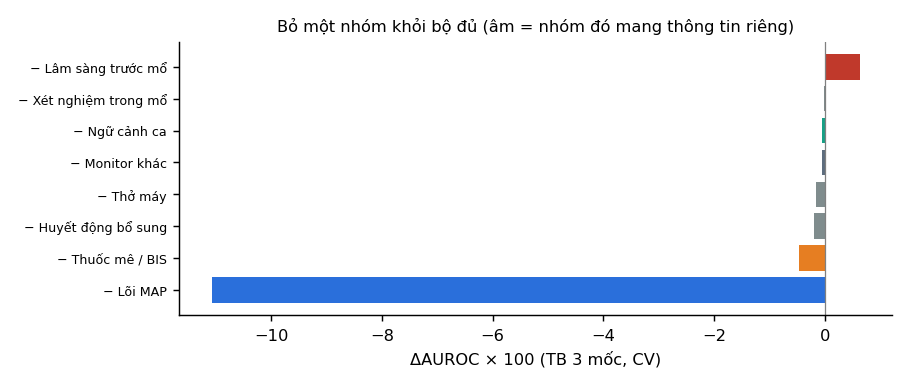

*Mức thay đổi AUROC (trung bình 3 mốc, CV) khi bỏ một nhóm khỏi bộ đủ. Âm nghĩa là nhóm đó mang thông tin riêng.*

**MAP đóng góp lớn nhất:** bỏ nhóm này làm AUROC CV giảm khoảng 0,11; bỏ thuốc mê / BIS giảm khoảng 0,005. Phần lớn đặc trưng khác trùng thông tin với MAP. Bỏ lâm sàng trước mổ làm CV tốt hơn nhưng chưa cho kết quả cùng chiều trên validation, nên chưa đủ bằng chứng kết luận cả nhóm không có ích.

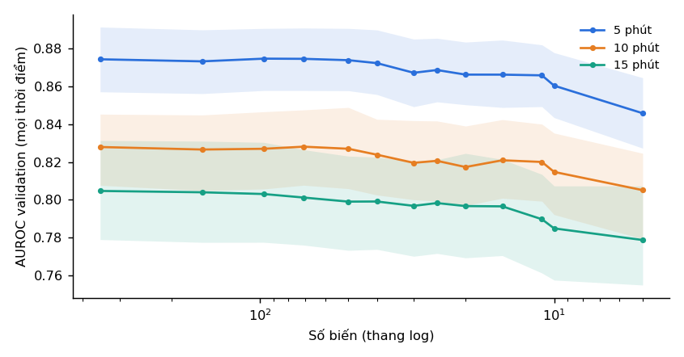

*AUROC trên validation theo số đặc trưng còn lại; vùng mờ là khoảng tin cậy 95%.*

| Số đặc trưng | AUROC 5 / 10 / 15 phút | Δ so với 349 ở mốc 15 phút [CI 95%] |
|--:|--:|--:|
| 349 | 0,874 / 0,828 / 0,805 | – |
| 97 | 0,875 / 0,827 / 0,803 | −0,002 [−0,005; +0,002] |
| **71** | **0,874 / 0,828 / 0,801** | **−0,004 [−0,009; +0,003]** |
| 50 | 0,874 / 0,827 / 0,799 | −0,006 [−0,013; +0,002] |
| 30 | 0,867 / 0,820 / 0,797 | −0,008 [−0,018; +0,001] |
| 11 | 0,866 / 0,820 / 0,790 | −0,015 [−0,024; −0,005] |

Em chọn 71 vì đây là bộ nhỏ nhất trên đường RFE có mức giảm AUROC không quá 0,004 và CI của chênh lệch chứa 0 ở cả ba mốc, theo ba cách đánh giá: mọi thời điểm, Hatib và Lee. Ở 5 và 10 phút, AUROC gần như không đổi. Từ 50 đặc trưng trở xuống, mức giảm ở 15 phút lớn dần. Bộ 11 do quy tắc dừng tự động theo CV chọn kém có ý nghĩa ở mốc này, nên không dùng. Dòng 97 trong bảng là một điểm RFE, không phải mô hình ngữ cảnh 97 đặc trưng của tuần 4.

So sánh trực tiếp bộ 71 và bộ 349 trong cùng thiết lập ablation, với số liệu trước khi làm tròn:

| Mốc | AUROC bộ 349 | AUROC bộ 71 | ΔAUROC, 71 − 349 [CI 95%] |
|---|--:|--:|--:|
| 5 phút | 0,8742 | 0,8744 | +0,0002 [−0,0025; +0,0030] |
| 10 phút | 0,8279 | 0,8281 | +0,0002 [−0,0039; +0,0040] |
| 15 phút | 0,8047 | 0,8012 | −0,0035 [−0,0093; +0,0027] |

Các CI đều chứa 0, nên chưa thấy mức giảm có ý nghĩa trong phép thử này; chưa chứng minh hai bộ tương đương. Điểm 71 đã được chọn sau khi xem validation, vì vậy còn cần xác nhận trên dữ liệu độc lập sau khi khóa cấu hình.

| Nhóm | Giữ / tổng |
|---|--:|
| Thuốc mê / BIS | 18 / 86 |
| Lõi MAP | 15 / 41 |
| Lâm sàng trước mổ | 11 / 52 |
| Huyết động bổ sung | 8 / 61 |
| Thở máy | 7 / 39 |
| Xét nghiệm trong mổ | 7 / 14 |
| Ngữ cảnh ca | 4 / 14 |
| Monitor khác | 1 / 42 |

Nhóm bị cắt mạnh nhất là monitor khác, chỉ còn 1/42. Đây là các đại lượng gần với MAP như chỉ số sốc hay NIBP, nên phần lớn chỉ lặp lại MAP. Nhóm thuốc mê giữ nhiều đặc trưng nhất, khớp với kết quả ở chương 5.

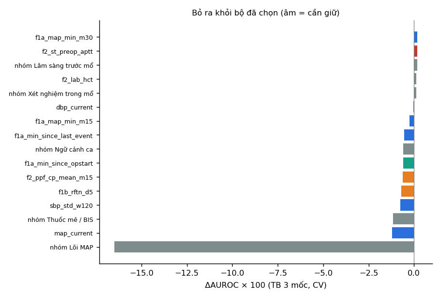

*Mức giảm AUROC (CV) khi bỏ từng đặc trưng khỏi bộ 11 đặc trưng nhỏ nhất trên đường RFE.*

Bỏ từng biến trong bộ 11 cho thấy mức huyết áp, độ dao động SBP, thay đổi remifentanil, nồng độ propofol và thời gian trong ca có thông tin bổ sung cho nhau. Bỏ MAP hiện tại hoặc cặp thuốc mê đều làm AUROC CV giảm khoảng 0,012. Phép thử này chỉ áp dụng cho bộ 11; không suy ra chỉ cần giữ bảy đặc trưng hoặc có thể bỏ các biến còn lại trong bộ 71.

**Bốn mô hình trên bộ 71 đã được train lại trên 2.393 ca**, kết quả ở chương 4. Phần còn thiếu là đánh giá bộ 71 và mô hình đầy đủ 349 với cùng dữ liệu train, cùng tập ca và luật cảnh báo. Không trừ trực tiếp AUROC 0,841 của bộ 349 trong báo cáo cũ với 0,827 của LightGBM 71: số cũ dùng tập đánh giá lớn hơn, gồm 6.559 đợt tụt eligible.

Bộ 71 vẫn có sáu cặp đặc trưng với |ρ| ≥ 0,95. Đây là hướng khảo sát tiếp; cấu hình hiện tại vẫn giữ nguyên 71 cột cho tới khi có kiểm tra lại trên train.

*Minh chứng: `src/uc04/ablation.py`, `scripts/ablation_214.py`, `scripts/near_dup_check.py`, `eda/ablation/`, `reports/weekly/week15/ablation/features_71.csv`, `reports/weekly/week15.md`.*

---

## 7. Trạm theo dõi mô phỏng và bàn giao (tuần 4–6)

Demo đầu tiên ở tuần 4–5 phát lại từng ca với mô hình 97 đặc trưng. Đến tuần 6, em thay bằng **trạm theo dõi 50 giường**, chạy LightGBM, CatBoost, TabM và logistic trên cùng bộ 71 đã chốt. Backend dùng FastAPI; frontend dùng React, TypeScript và biểu đồ SVG.

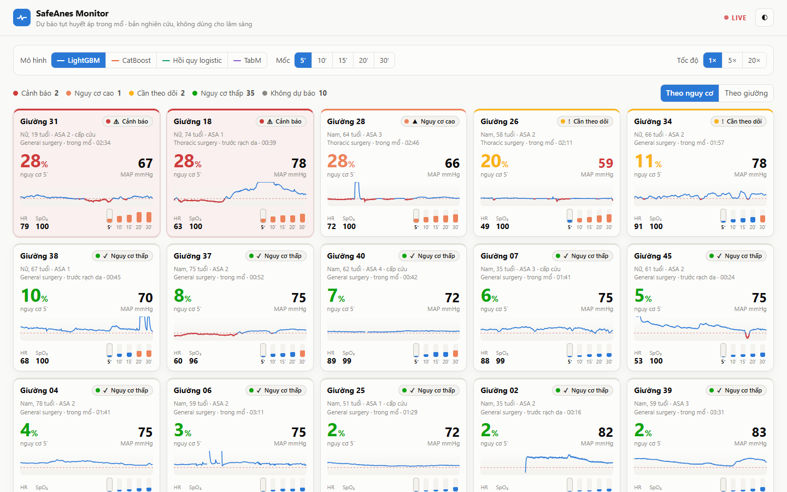

*Trạm theo dõi sắp giường theo nguy cơ, hiển thị MAP, HR, SpO₂ và nguy cơ ở năm mốc dự báo.*

| Trang | Chức năng hiện tại |
|---|---|
| Giới thiệu | Kết quả bốn mô hình, cách mô phỏng và nút bắt đầu |
| Trạm theo dõi | 50 giường; chọn mô hình, mốc dự báo, tốc độ phát lại 1× / 5× / 20× |
| Chi tiết giường | Bảng bốn mô hình × năm mốc, diễn tiến nguy cơ và MAP, nhật ký cảnh báo, ngữ cảnh ca, yếu tố giải thích |

Trạm dùng 50 ca test đã ghi, tổng cộng 151 đợt tụt. Sinh hiệu từ track Solar 8000 cập nhật mỗi 2 giây. Mỗi khi đồng hồ qua mốc 30 giây, máy chủ chạy bốn mô hình trên hàng đặc trưng có sẵn của thời điểm đó, rồi áp dụng luật cảnh báo như khi đánh giá. Dữ liệu chỉ được hiển thị tới thời điểm đang phát lại; đúng/sai của cảnh báo chỉ hiện khi đủ thời gian quan sát.

LightGBM dùng TreeSHAP, CatBoost dùng SHAP của mô hình, logistic dùng hệ số × giá trị. Với TabM, giao diện chỉ hiển thị giải thích của LightGBM để tham khảo; đó không phải phân rã dự báo TabM.

### Kiểm tra và triển khai

Em kiểm tra engine trên Kaggle với 20.344 hàng, bốn mô hình và năm mốc. Dự báo máy chủ khớp với dự báo đã lưu: sai khác tối đa dưới 7·10⁻¹⁶ với LightGBM, CatBoost và logistic, khoảng 3,11·10⁻⁸ với TabM. Một lần cập nhật 50 giường mất trung vị 0,055 giây trên CPU trong môi trường kiểm tra.

Bản triển khai dùng một Docker image cho giao diện và API, chạy trên Azure Container Apps với 1 vCPU, 2 GiB và tự tắt khi không có người xem. Dữ liệu bệnh nhân nằm trong HF dataset private, tải khi container khởi động; không đưa vào image hay git. Địa chỉ triển khai: [SafeAnes Monitor](https://safeanes-monitor.redriver-5424346f.eastasia.azurecontainerapps.io).

**Giới hạn:** bản hiện tại dự báo từ 71 đặc trưng đã tính sẵn, chưa tự tính đầy đủ từ tín hiệu thô hoặc nối monitor thật. Code tạo các cột `f2_*` chưa có trong repo. Chức năng tải CSV của bản cũ chưa được áp dụng cho bộ 71; cần module tính đặc trưng và kiểm tra khớp trước khi bổ sung. Nếu đổi dự báo sang mỗi 2 giây thì cũng phải đánh giá lại điều kiện cảnh báo theo thời gian.

### Checkpoint và thông tin tái lập

Đã đưa **20 file checkpoint** của bốn họ mô hình × năm mốc lên [SafeAnesUC04_models](https://huggingface.co/tuananhpham-vnu/SafeAnesUC04_models), kèm danh sách 71 cột, source hỗ trợ, cấu hình và provenance. Mã băm của các file tải lên đã được đối chiếu với file local; không đưa dữ liệu bệnh nhân hoặc dự báo từng ca vào repo model.

[Ghi chú huấn luyện](https://huggingface.co/tuananhpham-vnu/SafeAnesUC04_models/blob/main/TRAINING_NOTES.md) nêu rõ cách chọn đặc trưng và giới hạn tái lập. Checkpoint TabM tham chiếu `uc04.tabm.OneHorizon`, có trong source hỗ trợ. Provenance ghi Python 3.13.15, LightGBM 4.6.0, scikit-learn 1.6.1 và Torch 2.11.0+cpu; chưa có phiên bản CatBoost được xác nhận. Metadata không ghi commit huấn luyện đầy đủ, nên snapshot source hiện tại chưa được chứng minh trùng chính xác với code lúc train.

*Minh chứng: `deploy/backend/` (`app/models.py`, `app/ward.py`, `export_ward.py`, `check_engine.py`), `deploy/frontend/`, `deploy/README.md`, `deploy/AZURE.md`, `artifacts/v3/kaggle_dl/uc04-w16-ward-engine-check/check_engine.json`.*

---

## 8. Tổng kết

**Đến ngày 22/10/2026, em đã chốt LightGBM với 71 đặc trưng**, train lại trên 2.393 ca và đưa vào trạm theo dõi mô phỏng. AUROC validation đạt 0,888 / 0,848 / 0,827 / 0,818 / 0,805 ở năm mốc 5–30 phút. Ba mô hình CatBoost, TabM và logistic cũng đã được train lại, đưa lên HF và giữ trong demo để đối chiếu trên cùng dữ liệu.

Trong các thử nghiệm đã làm, lịch sử MAP đóng góp lớn nhất, sau đó là thay đổi thuốc mê. ECG/PPG và tổ hợp sinh lý bổ sung ít thông tin; chưa đủ cơ sở loại bỏ toàn bộ vai trò của lâm sàng trước mổ. Bộ 71 giảm 79,7% đầu vào so với bộ 349 và chưa cho thấy AUROC giảm có ý nghĩa trong ablation cùng thiết lập. Chưa kết luận mô hình cuối hơn hay tương đương mô hình đầy đủ khi cả hai cùng học trên train.

Cách đánh giá ảnh hưởng tới kết luận nhiều như mô hình. Theo cách chọn mẫu của Hatib, ngay cả ngưỡng MAP cũng đạt AUROC 0,92. Ở mức cảnh báo, đổi quy tắc làm độ nhạy thay đổi 16 điểm, trong khi đổi thuật toán chỉ thay đổi dưới 3 điểm. Vì vậy em giữ cách đánh giá ở mọi thời điểm và báo cáo cả độ nhạy lẫn số cảnh báo sai mỗi giờ.

Các việc còn lại tập trung vào xác nhận và hoàn thiện triển khai:

- So sánh mô hình 71 với bộ đầy đủ 349 khi cùng train trên 2.393 ca, cùng tập đánh giá và luật cảnh báo; bootstrap ghép cặp theo bệnh nhân cho AUROC, AUPRC và chỉ số cảnh báo. Huấn luyện và tính toán nặng chạy trên Kaggle.
- Sau khi khóa cấu hình, đánh giá trên dữ liệu độc lập mới. Validation đã tham gia chọn 71 cột và ngưỡng, còn test hiện có đã được dùng trước nên không còn là lần đánh giá cuối độc lập.
- Bổ sung module tính đúng bộ 71 từ tín hiệu thô, kiểm tra khớp với đặc trưng đã dùng khi train, rồi mở rộng sang luồng monitor và tải dữ liệu lên demo.
- Đánh giá lại ngưỡng theo hồ sơ nguy cơ trên LightGBM 71; bổ sung kiểm chứng của bác sĩ cho phần giải thích. Lớp LLM hiện vẫn chờ API key để chạy thật.
- Bổ sung source chính xác tại thời điểm train và phiên bản thư viện còn thiếu để hoàn thiện khả năng tái lập.

| Chương | Minh chứng chính |
|---|---|
| 1. Nghiên cứu, proposal | `UC04_RESEARCH_PLAN.md`, `docs/UC04_METHOD_PROPOSAL.md`, `docs/SOURCES.md` |
| 2. EDA | `reports/EDA/REPORT.md`, `reports/EDA/INSIGHTS.md` |
| 3. Dữ liệu | `scripts/data/`, `src/uc04/`, `configs/uc04_v3.json` |
| 4. Mô hình | `scripts/train_*.py`, `artifacts/v3/kaggle_dl/uc04-w16-v8-tabular/`, `uc04-w16-v8-tabm/`, `reports/weekly/week15.md` |
| 5. Phân tích | `src/uc04/`, `scripts/personalize.py`, `reports/weekly/week14.md` |
| 6. Ablation | `src/uc04/ablation.py`, `eda/ablation/`, `reports/weekly/week15.md` |
| 7. Demo và bàn giao | `deploy/`, `scripts/publish_model_checkpoints.py`, repo HF `tuananhpham-vnu/SafeAnesUC04_models` |

Lịch sử git có 28 commit từ 17/09 đến 17/10/2026 của tài khoản `tuananhphamvnu`.
