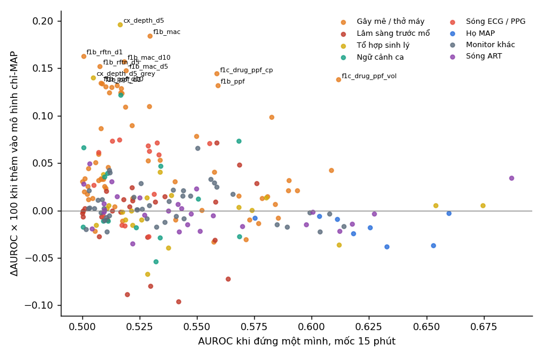
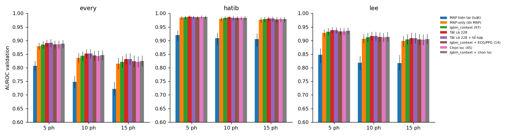

# EDA tuần 15: đặc trưng nào còn thêm được thông tin khi đã biết MAP

Sinh tự động từ `scripts/beyond_map_eda.py` (Kaggle). Mọi con số là đánh giá thật: CV 5 fold theo bệnh nhân trên train (dùng để chọn) hoặc validation (chỉ để báo cáo); test không được đọc. W = 120 s; mốc dự báo 5 / 10 / 15 phút; sự kiện MAP < 65 mmHg ≥ 60 s.

## Kết quả chính

1. **MAP mang gần hết thông tin.** Trên validation, mô hình chỉ dùng lõi MAP đạt AUROC 0,880 / 0,815 ở mốc 5 / 15 phút (luật "MAP hiện tại": 0,807 / 0,723); mô hình hiện tại `lgbm_context` chỉ hơn nó 0,006 đến 0,007.
2. **Phần lớn đặc trưng chỉ lặp lại MAP.** Trong 217 đặc trưng ngoài lõi MAP, 176 đến 180 có ý nghĩa khi đứng riêng nhưng chỉ 13 đến 19 còn ý nghĩa khi đã biết MAP (q < 0,05 cho cả OR và ΔAUROC).
3. **Phần thêm được ngoài MAP chủ yếu là thay đổi thuốc mê.** 14/23 đặc trưng có ý nghĩa ngoài MAP thuộc nhóm Gây mê / thở máy (Ce remifentanil / propofol thay đổi 1–10 phút, MAC và sevoflurane tăng, độ sâu mê gộp tăng trong 5 phút); mỗi đặc trưng chỉ thêm +0,0003 đến +0,0025 AUROC.
4. **Đặc trưng tổ hợp từ suy luận sinh lý không thêm gì.** 30 tổ hợp `cx_*`: 6 đúng dấu sinh lý, 20 ngược dấu sau khi đã biết MAP (phần lớn là MAP tính lại). Thêm cả 30 tổ hợp vào `Tất cả 214` đổi AUROC validation +0,0003 đến +0,0009.
5. **Sóng ECG / PPG thêm rất ít.** Thêm 14 đặc trưng ECG/PPG vào `lgbm_context`: ΔAUROC +0,0009 đến +0,0023, khoảng tin cậy chứa 0 ở 2/3 mốc; đổi lại phải có thêm pipeline sóng ECG_II + PLETH khi triển khai.
6. **Chọn bộ đặc trưng: `Tất cả 214`.** Dùng mọi đặc trưng (trừ ECG/PPG và tổ hợp) hơn `lgbm_context` +0,0044 đến +0,0081 AUROC trên validation, khoảng tin cậy không chứa 0 ở 3/3 mốc; bộ chọn tham lam `Chọn lọc (45)` (lõi MAP + 2 bước) chỉ ngang `lgbm_context` (+0,0000 đến +0,0007), vì phần thông tin thêm được rải trên nhiều đặc trưng gây mê nhỏ, không tập trung ở vài biến.

## Chi tiết dẫn tới việc chọn đặc trưng

### 1. Mốc so sánh: mô hình chỉ-MAP

Lõi MAP = mọi thống kê MAP/SBP/DBP trong W, xu hướng MAP 5–30 phút, thời gian ở vùng 65–80, % giảm so với nền, MAP ngoại suy, lịch sử đợt tụt trong ca. Logit out-of-fold của nó là mốc để đo mọi phần "thêm được" ở các mục sau. AUROC out-of-fold trên train:

| Mốc | Luật MAP hiện tại | LightGBM lõi MAP | Tỷ lệ dương |
|---|---|---|---|
| 5 phút | 0,814 | 0,887 | 5,1% |
| 10 phút | 0,756 | 0,847 | 9,7% |
| 15 phút | 0,734 | 0,830 | 13,8% |

### 2. Phần lớn đặc trưng chỉ lặp lại MAP

"Có ý nghĩa ngoài MAP" = hồi quy logistic có offset là logit chỉ-MAP cho OR/IQR có q < 0,05, và ΔAUROC (chỉ-MAP + biến so với chỉ-MAP, out-of-fold, ghép cặp) > 0 với q < 0,05. p tính từ SE bootstrap theo ca / cluster theo bệnh nhân, q = Benjamini–Hochberg trên mọi biến của một mốc.

| Mốc | Số đặc trưng | Có ý nghĩa khi đứng riêng | Có ý nghĩa ngoài MAP |
|---|---|---|---|
| 5 phút | 217 | 176 | 17 |
| 10 phút | 217 | 180 | 19 |
| 15 phút | 217 | 179 | 13 |

*Trục ngang: AUROC khi đứng một mình; trục dọc: AUROC thêm được khi đã có lõi MAP (mốc 15 phút). Nhiều biến mạnh khi đứng riêng nhưng gần 0 khi đã biết MAP.*

Ví dụ: các biến mạnh nhất khi đứng riêng (mốc 15 phút) nhưng không thêm gì khi đã biết MAP:

| Biến | Nhóm | AUROC đứng riêng | ΔAUROC khi thêm vào chỉ-MAP [CI] |
|---|---|---|---|
| `bt_svr_mean_w120` | Sóng ART | 0,687 | +0,0001 [-0,0003; +0,0005] |
| `cx_dsi` | Tổ hợp sinh lý | 0,675 | -0,0002 [-0,0005; +0,0001] |
| `cx_map_proj_5` | Tổ hợp sinh lý | 0,660 | -0,0002 [-0,0004; -0,0001] |
| `cx_msi` | Tổ hợp sinh lý | 0,654 | -0,0002 [-0,0004; +0,0002] |
| `cx_map_event_rate` | Tổ hợp sinh lý | 0,653 | -0,0005 [-0,0009; -0,0002] |
| `cx_map_grey_burden` | Tổ hợp sinh lý | 0,633 | -0,0006 [-0,0008; -0,0005] |
| `bt_sv_mean_w120` | Sóng ART | 0,627 | -0,0002 [-0,0006; +0,0002] |
| `cx_map_proj_10` | Tổ hợp sinh lý | 0,625 | -0,0004 [-0,0006; -0,0003] |

### 3. Những đặc trưng còn thêm được khi đã biết MAP

Mọi đặc trưng có ý nghĩa ngoài MAP ở ít nhất một mốc (23 đặc trưng):

| Biến | Nhóm | Ý nghĩa | Hướng | ΔAUROC 5' / 10' / 15' | Có ý nghĩa ở mốc |
|---|---|---|---|---|---|
| `cx_depth_d5` | Tổ hợp sinh lý | Thay đổi độ sâu mê gộp 5 phút | cao → nguy cơ | +0,0022 / +0,0025 / +0,0018 | 5', 10', 15' |
| `f1b_rftn_d1` | Gây mê / thở máy | Nồng độ đích Ce remifentanil (TCI), thay đổi 1 phút | thấp → nguy cơ | +0,0017 / +0,0021 / +0,0014 | 5', 10', 15' |
| `f1b_rftn_d5` | Gây mê / thở máy | Nồng độ đích Ce remifentanil (TCI), thay đổi 5 phút | cao → nguy cơ | +0,0017 / +0,0020 / +0,0013 | 5', 10', 15' |
| `f1b_rftn_d10` | Gây mê / thở máy | Nồng độ đích Ce remifentanil (TCI), thay đổi 10 phút | cao → nguy cơ | +0,0016 / +0,0018 / +0,0011 | 5', 10', 15' |
| `f1b_mac_d10` | Gây mê / thở máy | Nồng độ phế nang tối thiểu của khí mê (MAC), thay đổi 10 phút | cao → nguy cơ | +0,0017 / +0,0016 / +0,0014 | 5', 10', 15' |
| `f1b_mac` | Gây mê / thở máy | Nồng độ phế nang tối thiểu của khí mê (MAC) | cao → nguy cơ | +0,0012 / +0,0016 / +0,0017 | 5', 10', 15' |
| `f1b_mac_d5` | Gây mê / thở máy | Nồng độ phế nang tối thiểu của khí mê (MAC), thay đổi 5 phút | cao → nguy cơ | +0,0013 / +0,0017 / +0,0013 | 5', 10', 15' |
| `cx_depth_d5_grey` | Tổ hợp sinh lý | Tăng độ sâu mê khi MAP đang ở vùng xám | cao → nguy cơ | +0,0013 / +0,0014 / +0,0012 | 5', 10', 15' |
| `f1b_ppf_d1` | Gây mê / thở máy | Nồng độ đích Ce propofol (TCI, ước lượng dược động học), thay đổi 1 phút | thấp → nguy cơ | +0,0004 / +0,0008 / +0,0012 | 10', 15' |
| `f1c_drug_exp_sevo_d5` | Gây mê / thở máy | Nồng độ sevoflurane thở ra, thay đổi 5 phút | cao → nguy cơ | +0,0010 / +0,0012 / +0,0009 | 5', 10', 15' |
| `f1b_ppf_d5` | Gây mê / thở máy | Nồng độ đích Ce propofol (TCI, ước lượng dược động học), thay đổi 5 phút | thấp → nguy cơ | +0,0004 / +0,0009 / +0,0012 | 10', 15' |
| `f1c_drug_exp_sevo` | Gây mê / thở máy | Nồng độ sevoflurane thở ra | cao → nguy cơ | +0,0008 / +0,0009 / +0,0010 | 5', 10' |
| `f1b_ppf_d10` | Gây mê / thở máy | Nồng độ đích Ce propofol (TCI, ước lượng dược động học), thay đổi 10 phút | thấp → nguy cơ | +0,0004 / +0,0009 / +0,0012 | 10' |
| `f1b_mac_d1` | Gây mê / thở máy | Nồng độ phế nang tối thiểu của khí mê (MAC), thay đổi 1 phút | cao → nguy cơ | +0,0008 / +0,0008 / +0,0007 | 5', 10', 15' |
| `etco2_std_w120` | Monitor khác | CO2 cuối thì thở ra (gián tiếp phản ánh cung lượng tim và thông khí): độ lệch chuẩn trong 120 s | cao → nguy cơ | +0,0004 / +0,0006 / +0,0004 | 5', 10' |
| `f1b_approach_open` | Lâm sàng trước mổ | Đường mổ: open | cao → nguy cơ | +0,0006 / +0,0004 / +0,0004 | 5' |
| `ep_pat_slope` | Sóng ECG / PPG | Độ dốc PAT (mỗi phút) | cao → nguy cơ | +0,0003 / +0,0006 / +0,0006 | 10' |
| `f1a_hr_slope_m5` | Ngữ cảnh ca | Nhịp tim: độ dốc (mỗi phút) trong 5 phút | thấp → nguy cơ | +0,0002 / +0,0005 / +0,0005 | 10', 15' |
| `f1c_vent_compliance_d1` | Gây mê / thở máy | Độ giãn nở phổi, thay đổi 1 phút | cao → nguy cơ | +0,0005 / +0,0004 / +0,0003 | 10' |
| `f1b_approach_videoscopic` | Lâm sàng trước mổ | Đường mổ: videoscopic | thấp → nguy cơ | +0,0004 / +0,0002 / +0,0000 | 5' |
| `bt_co_slope_w120` | Sóng ART | Proxy cung lượng tim = SV proxy × HR (tính từ huyết áp): độ dốc (mỗi phút) theo nhịp trong 120 s | thấp → nguy cơ | +0,0003 / +0,0003 / +0,0003 | 5', 10' |
| `f1c_vent_compliance_d5` | Gây mê / thở máy | Độ giãn nở phổi, thay đổi 5 phút | cao → nguy cơ | +0,0003 / +0,0003 / +0,0003 | 5' |
| `bt_svr_slope_w120` | Sóng ART | Proxy kháng lực mạch hệ thống = MAP / CO proxy (tính từ huyết áp): độ dốc (mỗi phút) theo nhịp trong 120 s | thấp → nguy cơ | +0,0003 / +0,0001 / +0,0000 | 5' |

Đây là lý do giữ nhóm gây mê / thở máy trong bộ đặc trưng: chúng mang thông tin về **nguyên nhân** (tăng thuốc mê làm giãn mạch) mà các con số huyết áp chưa phản ánh tại thời điểm dự báo.

### 4. Đặc trưng tổ hợp sinh lý

30 tổ hợp dựng từ MAP = HR × SV × SVR, chỉ số sốc, MAP dự phóng, mất bù nhịp tim, EtCO₂, độ sâu mê gộp, PPV ở vùng xám, giai đoạn trước rạch da. Kiểm tra: dấu quan sát (ρ với phần dư MAP, mốc 15 phút) có khớp dấu sinh lý kỳ vọng không. Kết quả: 20 ngược, 6 đúng, 2 không có kỳ vọng, 2 không có ý nghĩa.

Các tổ hợp đúng dấu sinh lý:

| Tổ hợp | Giả thuyết | ΔAUROC 5' / 15' |
|---|---|---|
| `cx_depth_d5` | Thay đổi độ sâu mê gộp 5 phút | +0,0023 / +0,0020 |
| `cx_depth_d5_grey` | Tăng độ sâu mê khi MAP đang ở vùng xám | +0,0014 / +0,0014 |
| `cx_dlog_svr` | Δlog SVR proxy = Δlog MAP − Δlog HR − Δlog SV | -0,0002 / +0,0001 |
| `cx_depth` | Chỉ số độ sâu mê gộp: Ce ppf/3 + Ce rftn/4 + MAC | -0,0002 / +0,0000 |
| `cx_etco2_per_mv` | EtCO2 / thông khí phút (CO2 đến phổi theo thông khí) | -0,0001 / -0,0002 |
| `cx_depth_age` | Độ sâu mê gộp × tuổi/60 (người già nhạy thuốc) | -0,0003 / -0,0007 |

Chỉ hai tổ hợp về thay đổi độ sâu mê thêm được thông tin, và thông tin đó đã có trong các cột thuốc mê gốc; nên bộ đặc trưng không giữ tổ hợp.

### 5. Sóng ECG / PPG

14 đặc trưng tự trích xuất từ SNUADC/ECG_II và SNUADC/PLETH (HRV, thời gian truyền sóng PAT, biên độ PPG), nhân quả, W = 120 s. Khi đã biết MAP: chỉ `ep_pat_slope` có ý nghĩa ở ít nhất một mốc.

Thêm cả khối vào `lgbm_context` (validation, `lgbm_context + ECG/PPG (14)` so với `lgbm_context (97)`):

| Protocol | ΔAUROC 5' [CI] | ΔAUROC 10' [CI] | ΔAUROC 15' [CI] |
|---|---|---|---|
| Mọi thời điểm | +0,0009 [-0,0004; +0,0022] | +0,0018 [-0,0004; +0,0038] | +0,0023 [+0,0002; +0,0048] |
| Lee / HypoBridCast | +0,0006 [-0,0005; +0,0019] | +0,0012 [-0,0007; +0,0035] | +0,0006 [-0,0010; +0,0023] |
| Hatib | -0,0001 [-0,0010; +0,0011] | -0,0002 [-0,0018; +0,0015] | -0,0013 [-0,0028; +0,0000] |

Mức thêm này không đủ bù cho pipeline sóng phải có khi triển khai, nên bộ đặc trưng không giữ ECG/PPG.

### 6. So sánh các bộ đặc trưng trên validation

AUROC (mọi thời điểm), chênh lệch so với `lgbm_context` [CI 95% bootstrap ghép cặp theo bệnh nhân] và AUPRC. Các mô hình fit trên toàn bộ train, chỉ chấm trên validation.

| Bộ đặc trưng | AUROC 5' | Δ vs context 5' [CI] | AUROC 10' | Δ vs context 10' [CI] | AUROC 15' | Δ vs context 15' [CI] | AUPRC 5' / 15' |
|---|---|---|---|---|---|---|---|
| `MAP hiện tại (luật)` | 0,807 | -0,0781 [-0,0931; -0,0626] | 0,748 | -0,0959 [-0,1125; -0,0753] | 0,723 | -0,0994 [-0,1228; -0,0747] | 0,229 / 0,318 |
| `MAP-only (lõi MAP)` | 0,880 | -0,0059 [-0,0088; -0,0031] | 0,836 | -0,0074 [-0,0116; -0,0033] | 0,815 | -0,0072 [-0,0116; -0,0023] | 0,324 / 0,427 |
| `lgbm_context (97)` | 0,885 | mốc | 0,844 | mốc | 0,822 | mốc | 0,345 / 0,438 |
| `lgbm_context + ECG/PPG (14)` | 0,886 | +0,0009 [-0,0004; +0,0022] | 0,846 | +0,0018 [-0,0004; +0,0038] | 0,824 | +0,0023 [+0,0002; +0,0048] | 0,349 / 0,450 |
| `Chọn lọc (45)` | 0,886 | +0,0007 [-0,0019; +0,0034] | 0,844 | +0,0000 [-0,0040; +0,0043] | 0,822 | +0,0002 [-0,0048; +0,0055] | 0,335 / 0,438 |
| `Tất cả 214` | 0,890 | +0,0044 [+0,0018; +0,0074] | 0,850 | +0,0066 [+0,0029; +0,0111] | 0,830 | +0,0081 [+0,0032; +0,0132] | 0,338 / 0,458 |
| `Tất cả 228` | 0,890 | +0,0050 [+0,0022; +0,0081] | 0,852 | +0,0085 [+0,0051; +0,0132] | 0,832 | +0,0097 [+0,0045; +0,0147] | 0,345 / 0,465 |
| `Tất cả 214 + tổ hợp` | 0,890 | +0,0048 [+0,0021; +0,0087] | 0,851 | +0,0074 [+0,0039; +0,0127] | 0,830 | +0,0084 [+0,0036; +0,0140] | 0,342 / 0,460 |
| `Tất cả 228 + tổ hợp` | 0,891 | +0,0058 [+0,0032; +0,0091] | 0,853 | +0,0088 [+0,0051; +0,0140] | 0,832 | +0,0102 [+0,0056; +0,0157] | 0,347 / 0,464 |

Theo protocol Lee 2021 / HypoBridCast 2026 (bỏ mẫu âm khó), AUROC mốc 15 phút: `MAP hiện tại (luật)` 0,817; `MAP-only (lõi MAP)` 0,898; `lgbm_context (97)` 0,904; `lgbm_context + ECG/PPG (14)` 0,905; `Chọn lọc (45)` 0,903; `Tất cả 214` 0,908; `Tất cả 228` 0,908; `Tất cả 214 + tổ hợp` 0,908; `Tất cả 228 + tổ hợp` 0,909. Mọi mô hình đều cao hơn vì protocol này bỏ các thời điểm MAP thấp mà không tụt.

## Số liệu đầy đủ

- `l1_conditional.csv`, `l1_stats_h*.csv`: mọi đặc trưng, mọi mốc (AUROC riêng, ρ với phần dư MAP, OR/IQR, ΔAUROC, q)
- `spearman.csv`: tương quan Spearman giữa mọi cặp đặc trưng
- `l2_synergy.csv`, `l2_shap_interaction.csv`: cặp đặc trưng và biến điều biến tác động của MAP
- `l3_composites.csv`: các tổ hợp sinh lý
- `l4_forward.csv`, `l4_prefix.csv`, `ladder_validation.csv`: chọn tham lam và trước / sau trên validation
- `final_compare.csv`, `inference_cost.csv`: so sánh cuối 3 protocol, chi phí suy luận
- `no_ecg/`: cùng phân tích khi không có ECG/PPG
