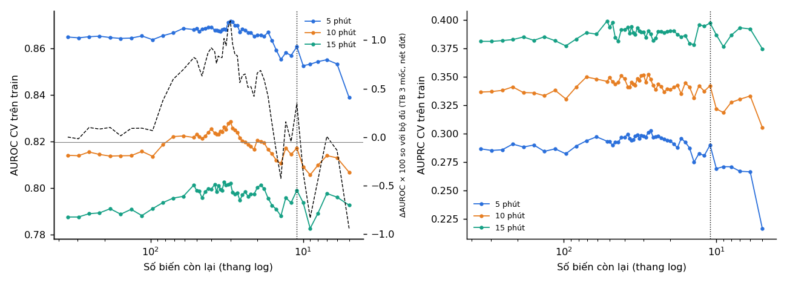

# Ablation 349 đặc trưng (tuần 15)

Sinh tự động từ `scripts/ablation_214.py` (Kaggle). Bộ gốc: 349 cột đã làm sạch của `lgbm_full_v4` (`features_v8`); 349 đặc trưng = Lõi MAP 41; Monitor khác 42; Ngữ cảnh ca 14; Thuốc mê / BIS 86; Thở máy 39; Huyết động bổ sung 61; Xét nghiệm trong mổ 14; Lâm sàng trước mổ 52. W = 120 s, mốc 5 / 10 / 15 phút. Chọn trên **calibration** (CV 5 fold theo bệnh nhân, 84.643 dòng); mô hình báo cáo trên validation được fit trên toàn bộ calibration; validation chỉ để báo cáo; test không đọc.

Quy ước: ΔAUROC trung bình 3 mốc < −0,0005 là **mất thông tin**, > 0,0005 là **tốt hơn khi bỏ**, còn lại **không đổi**. Mô hình: LightGBM tham số `configs/uc04_v3.json` (500 cây, 7 lá).

## 2. Loại dần từng đặc trưng (RFE theo |SHAP|)

Mỗi bước: fit CV trên bộ hiện tại cho cả 3 mốc, xếp hạng bằng |SHAP| trung bình trên fold giữ lại, bỏ 15 % biến yếu nhất khi còn > 60 biến, 5 % (ít nhất 1) khi ≤ 60; biến chưa từng được dùng luôn bị bỏ.

**Điểm dừng (chọn trên train):** bộ nhỏ nhất có ΔAUROC ≥ −0,0005 và ΔAUPRC ≥ −0,0020 so với 349: **11 biến** (bước 46, ΔAUROC +0,0035, ΔAUPRC +0,0084).

Kích thước nhỏ nhất theo từng ngưỡng chịu mất AUROC: −0,0005: 7 biến; −0,0010: 7 biến; −0,0020: 6 biến; −0,0050: 6 biến; −0,0100: 5 biến.

| Số biến | AUROC | AUPRC | ΔAUROC | ΔAUROC 5' / 10' / 15' | ΔAUPRC | Fold xấu nhất |
|---|---|---|---|---|---|---|
| 349 | 0,8223 | 0,3347 | +0,0000 | +0,0000 / +0,0000 / +0,0000 | +0,0000 | +0,0000 |
| 157 | 0,8224 | 0,3359 | +0,0001 | -0,0006 / -0,0002 / +0,0012 | +0,0012 | -0,0037 |
| 97 | 0,8229 | 0,3299 | +0,0007 | -0,0011 / -0,0004 / +0,0036 | -0,0048 | -0,0021 |
| 71 | 0,8282 | 0,3440 | +0,0060 | +0,0018 / +0,0080 / +0,0081 | +0,0094 | +0,0034 |
| 50 | 0,8303 | 0,3453 | +0,0080 | +0,0037 / +0,0091 / +0,0114 | +0,0106 | +0,0015 |
| 40 | 0,8315 | 0,3454 | +0,0092 | +0,0043 / +0,0114 / +0,0119 | +0,0107 | +0,0031 |
| 30 | 0,8342 | 0,3463 | +0,0120 | +0,0069 / +0,0145 / +0,0146 | +0,0116 | +0,0041 |
| 25 | 0,8286 | 0,3399 | +0,0064 | +0,0034 / +0,0062 / +0,0095 | +0,0052 | +0,0022 |
| 20 | 0,8289 | 0,3407 | +0,0066 | +0,0007 / +0,0065 / +0,0126 | +0,0060 | -0,0024 |
| 15 | 0,8208 | 0,3359 | -0,0015 | -0,0056 / -0,0022 / +0,0033 | +0,0012 | -0,0188 |
| 11 | 0,8257 | 0,3431 | +0,0035 | -0,0042 / +0,0031 / +0,0115 | +0,0084 | -0,0060 |
| 10 | 0,8186 | 0,3258 | -0,0037 | -0,0123 / -0,0049 / +0,0062 | -0,0089 | -0,0121 |
| 5 | 0,8128 | 0,2988 | -0,0094 | -0,0261 / -0,0073 / +0,0051 | -0,0359 | -0,0249 |

Số biến còn lại trong bộ chọn theo nhóm: Lõi MAP 6/41; Monitor khác 0/42; Ngữ cảnh ca 1/14; Thuốc mê / BIS 2/86; Thở máy 0/39; Huyết động bổ sung 0/61; Xét nghiệm trong mổ 1/14; Lâm sàng trước mổ 1/52.

### Bộ 11 biến được chọn

| Biến | Nhóm | Ý nghĩa | |SHAP| chuẩn hóa |
|---|---|---|---|
| `f1a_map_min_m15` | Lõi MAP | Huyết áp động mạch trung bình: giá trị thấp nhất trong 15 phút | 0,136 |
| `map_current` | Lõi MAP | Huyết áp động mạch trung bình: giá trị hiện tại | 0,124 |
| `f1a_map_min_m30` | Lõi MAP | Huyết áp động mạch trung bình: giá trị thấp nhất trong 30 phút | 0,105 |
| `dbp_current` | Lõi MAP | Huyết áp tâm trương: giá trị hiện tại | 0,105 |
| `sbp_std_w120` | Lõi MAP | Huyết áp tâm thu: độ lệch chuẩn trong 120 s | 0,088 |
| `f1a_min_since_last_event` | Lõi MAP | Số phút từ đợt tụt gần nhất | 0,084 |
| `f2_ppf_cp_mean_m15` | Thuốc mê / BIS | f2_ppf_cp_mean_m15 | 0,084 |
| `f2_lab_hct` | Xét nghiệm trong mổ | f2_lab_hct | 0,075 |
| `f2_st_preop_aptt` | Lâm sàng trước mổ | f2_st_preop_aptt | 0,069 |
| `f1a_min_since_opstart` | Ngữ cảnh ca | Số phút từ lúc rạch da (thiếu trước rạch da) | 0,068 |
| `f1b_rftn_d5` | Thuốc mê / BIS | Nồng độ đích Ce remifentanil (TCI), thay đổi 5 phút | 0,063 |

## 3. Bỏ từng biến / từng nhóm khỏi bộ đã chọn (CV)

Mốc là bộ đã chọn; ΔAUROC âm = biến đó mang thông tin không thay được bằng các biến còn lại.

| Bỏ ra | Số biến bỏ | ΔAUROC | ΔAUROC 5' / 10' / 15' | ΔAUPRC | Fold xấu hơn | Kết luận |
|---|---|---|---|---|---|---|
| nhóm Lõi MAP | 6 | -0,1649 | -0,1974 / -0,1585 / -0,1387 | -0,1774 | 5/5 | mất thông tin |
| map_current | 1 | -0,0120 | -0,0173 / -0,0097 / -0,0088 | -0,0306 | 5/5 | mất thông tin |
| nhóm Thuốc mê / BIS | 2 | -0,0116 | -0,0131 / -0,0106 / -0,0112 | -0,0244 | 5/5 | mất thông tin |
| sbp_std_w120 | 1 | -0,0075 | -0,0079 / -0,0079 / -0,0067 | -0,0105 | 4/5 | mất thông tin |
| f1b_rftn_d5 | 1 | -0,0071 | -0,0081 / -0,0080 / -0,0053 | -0,0173 | 5/5 | mất thông tin |
| f2_ppf_cp_mean_m15 | 1 | -0,0062 | -0,0059 / -0,0060 / -0,0067 | -0,0123 | 4/5 | mất thông tin |
| f1a_min_since_opstart | 1 | -0,0058 | -0,0028 / -0,0054 / -0,0092 | -0,0062 | 4/5 | mất thông tin |
| nhóm Ngữ cảnh ca | 1 | -0,0058 | -0,0028 / -0,0054 / -0,0092 | -0,0062 | 4/5 | mất thông tin |
| f1a_min_since_last_event | 1 | -0,0053 | -0,0047 / -0,0068 / -0,0044 | -0,0099 | 4/5 | mất thông tin |
| f1a_map_min_m15 | 1 | -0,0024 | +0,0006 / -0,0028 / -0,0051 | -0,0018 | 3/5 | mất thông tin |
| dbp_current | 1 | -0,0004 | -0,0011 / +0,0001 / -0,0003 | -0,0018 | 4/5 | không đổi |
| nhóm Xét nghiệm trong mổ | 1 | +0,0014 | -0,0008 / +0,0021 / +0,0028 | -0,0037 | 2/5 | tốt hơn khi bỏ |
| f2_lab_hct | 1 | +0,0014 | -0,0008 / +0,0021 / +0,0028 | -0,0037 | 2/5 | tốt hơn khi bỏ |
| nhóm Lâm sàng trước mổ | 1 | +0,0018 | +0,0024 / +0,0007 / +0,0024 | +0,0067 | 1/5 | tốt hơn khi bỏ |
| f2_st_preop_aptt | 1 | +0,0018 | +0,0024 / +0,0007 / +0,0024 | +0,0067 | 1/5 | tốt hơn khi bỏ |
| f1a_map_min_m30 | 1 | +0,0018 | +0,0008 / +0,0015 / +0,0032 | +0,0046 | 1/5 | tốt hơn khi bỏ |

## 4. Validation: các điểm trên đường RFE

Chỉ báo cáo, không dùng để chọn. Khác biệt so với bộ đủ là bootstrap theo bệnh nhân, ghép cặp (cùng mẫu lại).

Protocol `every`:

| Mô hình | Số biến | AUROC 5' | Δ vs 349 5' [CI] | AUPRC 5' | AUROC 10' | Δ vs 349 10' [CI] | AUPRC 10' | AUROC 15' | Δ vs 349 15' [CI] | AUPRC 15' |
|---|---|---|---|---|---|---|---|---|---|---|
| MAP hiện tại (luật) | 1 | 0,807 | -0,0669 [-0,0810; -0,0508] | 0,229 | 0,748 | -0,0800 [-0,0984; -0,0599] | 0,274 | 0,723 | -0,0821 [-0,1059; -0,0570] | 0,318 |
| MAP-only (lõi MAP) | 41 | 0,867 | -0,0070 [-0,0128; -0,0018] | 0,303 | 0,820 | -0,0077 [-0,0187; +0,0029] | 0,351 | 0,796 | -0,0091 [-0,0231; +0,0062] | 0,394 |
| lgbm_context (97) | 97 | 0,875 | +0,0006 [-0,0051; +0,0056] | 0,321 | 0,828 | -0,0003 [-0,0095; +0,0081] | 0,356 | 0,804 | -0,0008 [-0,0110; +0,0103] | 0,398 |
| Tất cả 349 | 349 | 0,874 | +0,0000 [+0,0000; +0,0000] | 0,296 | 0,828 | +0,0000 [+0,0000; +0,0000] | 0,347 | 0,805 | +0,0000 [+0,0000; +0,0000] | 0,405 |
| RFE 157 | 157 | 0,873 | -0,0011 [-0,0035; +0,0011] | 0,292 | 0,827 | -0,0013 [-0,0038; +0,0010] | 0,344 | 0,804 | -0,0007 [-0,0035; +0,0025] | 0,403 |
| RFE 97 | 97 | 0,875 | +0,0003 [-0,0025; +0,0034] | 0,294 | 0,827 | -0,0009 [-0,0063; +0,0034] | 0,348 | 0,803 | -0,0016 [-0,0053; +0,0021] | 0,398 |
| RFE 71 | 71 | 0,874 | +0,0002 [-0,0025; +0,0030] | 0,297 | 0,828 | +0,0002 [-0,0039; +0,0040] | 0,354 | 0,801 | -0,0035 [-0,0093; +0,0027] | 0,404 |
| RFE 50 | 50 | 0,874 | -0,0005 [-0,0039; +0,0032] | 0,290 | 0,827 | -0,0009 [-0,0069; +0,0047] | 0,351 | 0,799 | -0,0056 [-0,0130; +0,0023] | 0,398 |
| RFE 40 | 40 | 0,872 | -0,0020 [-0,0054; +0,0022] | 0,281 | 0,824 | -0,0041 [-0,0119; +0,0021] | 0,340 | 0,799 | -0,0056 [-0,0135; +0,0030] | 0,388 |
| RFE 30 | 30 | 0,867 | -0,0071 [-0,0119; -0,0022] | 0,277 | 0,820 | -0,0083 [-0,0174; -0,0002] | 0,331 | 0,797 | -0,0079 [-0,0180; +0,0011] | 0,383 |
| RFE 25 | 25 | 0,869 | -0,0057 [-0,0107; +0,0002] | 0,289 | 0,821 | -0,0073 [-0,0158; +0,0011] | 0,343 | 0,798 | -0,0064 [-0,0163; +0,0030] | 0,380 |
| RFE 20 | 20 | 0,866 | -0,0081 [-0,0136; -0,0029] | 0,283 | 0,817 | -0,0106 [-0,0203; -0,0021] | 0,338 | 0,797 | -0,0080 [-0,0176; +0,0029] | 0,379 |
| RFE 15 | 15 | 0,866 | -0,0081 [-0,0143; -0,0013] | 0,279 | 0,821 | -0,0070 [-0,0161; +0,0014] | 0,336 | 0,797 | -0,0081 [-0,0176; +0,0011] | 0,374 |
| RFE 10 | 10 | 0,860 | -0,0139 [-0,0206; -0,0074] | 0,277 | 0,815 | -0,0131 [-0,0231; -0,0034] | 0,330 | 0,785 | -0,0198 [-0,0300; -0,0077] | 0,366 |
| RFE 5 | 5 | 0,846 | -0,0285 [-0,0384; -0,0180] | 0,232 | 0,805 | -0,0228 [-0,0352; -0,0101] | 0,314 | 0,779 | -0,0259 [-0,0390; -0,0084] | 0,359 |
| RFE 11 (chọn) | 11 | 0,866 | -0,0085 [-0,0149; -0,0032] | 0,280 | 0,820 | -0,0079 [-0,0175; +0,0007] | 0,337 | 0,790 | -0,0149 [-0,0242; -0,0047] | 0,377 |

Protocol `lee`:

| Mô hình | Số biến | AUROC 5' | Δ vs 349 5' [CI] | AUPRC 5' | AUROC 10' | Δ vs 349 10' [CI] | AUPRC 10' | AUROC 15' | Δ vs 349 15' [CI] | AUPRC 15' |
|---|---|---|---|---|---|---|---|---|---|---|
| MAP hiện tại (luật) | 1 | 0,848 | -0,0779 [-0,0974; -0,0614] | 0,464 | 0,818 | -0,0799 [-0,1039; -0,0590] | 0,404 | 0,817 | -0,0682 [-0,0936; -0,0422] | 0,393 |
| MAP-only (lõi MAP) | 41 | 0,919 | -0,0069 [-0,0126; -0,0008] | 0,445 | 0,894 | -0,0037 [-0,0119; +0,0073] | 0,344 | 0,884 | -0,0012 [-0,0134; +0,0107] | 0,266 |
| lgbm_context (97) | 97 | 0,926 | -0,0001 [-0,0049; +0,0045] | 0,462 | 0,902 | +0,0039 [-0,0037; +0,0135] | 0,346 | 0,891 | +0,0052 [-0,0040; +0,0148] | 0,295 |
| Tất cả 349 | 349 | 0,926 | +0,0000 [+0,0000; +0,0000] | 0,377 | 0,898 | +0,0000 [+0,0000; +0,0000] | 0,275 | 0,885 | +0,0000 [+0,0000; +0,0000] | 0,224 |
| RFE 157 | 157 | 0,924 | -0,0018 [-0,0036; -0,0002] | 0,355 | 0,898 | +0,0003 [-0,0019; +0,0028] | 0,264 | 0,885 | -0,0005 [-0,0027; +0,0023] | 0,214 |
| RFE 97 | 97 | 0,925 | -0,0006 [-0,0033; +0,0016] | 0,365 | 0,898 | -0,0000 [-0,0036; +0,0035] | 0,261 | 0,885 | -0,0008 [-0,0043; +0,0026] | 0,206 |
| RFE 71 | 71 | 0,925 | -0,0009 [-0,0037; +0,0015] | 0,361 | 0,897 | -0,0011 [-0,0055; +0,0024] | 0,269 | 0,884 | -0,0019 [-0,0066; +0,0030] | 0,239 |
| RFE 50 | 50 | 0,924 | -0,0013 [-0,0043; +0,0020] | 0,359 | 0,895 | -0,0029 [-0,0085; +0,0018] | 0,278 | 0,883 | -0,0021 [-0,0085; +0,0049] | 0,205 |
| RFE 40 | 40 | 0,923 | -0,0023 [-0,0054; +0,0010] | 0,347 | 0,893 | -0,0054 [-0,0114; -0,0000] | 0,238 | 0,882 | -0,0037 [-0,0095; +0,0038] | 0,186 |
| RFE 30 | 30 | 0,919 | -0,0070 [-0,0115; -0,0031] | 0,357 | 0,893 | -0,0055 [-0,0119; +0,0002] | 0,234 | 0,880 | -0,0052 [-0,0124; +0,0025] | 0,186 |
| RFE 25 | 25 | 0,920 | -0,0060 [-0,0102; -0,0014] | 0,364 | 0,891 | -0,0071 [-0,0131; -0,0010] | 0,270 | 0,881 | -0,0043 [-0,0134; +0,0049] | 0,196 |
| RFE 20 | 20 | 0,919 | -0,0067 [-0,0118; -0,0015] | 0,380 | 0,888 | -0,0098 [-0,0180; -0,0027] | 0,270 | 0,880 | -0,0051 [-0,0157; +0,0040] | 0,222 |
| RFE 15 | 15 | 0,919 | -0,0068 [-0,0126; -0,0017] | 0,361 | 0,893 | -0,0052 [-0,0128; +0,0020] | 0,249 | 0,879 | -0,0062 [-0,0163; +0,0037] | 0,194 |
| RFE 10 | 10 | 0,916 | -0,0100 [-0,0164; -0,0045] | 0,375 | 0,890 | -0,0080 [-0,0182; +0,0010] | 0,223 | 0,874 | -0,0115 [-0,0226; -0,0021] | 0,172 |
| RFE 5 | 5 | 0,906 | -0,0192 [-0,0269; -0,0114] | 0,208 | 0,880 | -0,0180 [-0,0300; -0,0059] | 0,179 | 0,871 | -0,0144 [-0,0246; -0,0020] | 0,142 |
| RFE 11 (chọn) | 11 | 0,919 | -0,0069 [-0,0129; -0,0017] | 0,361 | 0,892 | -0,0064 [-0,0150; +0,0005] | 0,232 | 0,876 | -0,0094 [-0,0207; -0,0007] | 0,188 |

Protocol `hatib`:

| Mô hình | Số biến | AUROC 5' | Δ vs 349 5' [CI] | AUPRC 5' | AUROC 10' | Δ vs 349 10' [CI] | AUPRC 10' | AUROC 15' | Δ vs 349 15' [CI] | AUPRC 15' |
|---|---|---|---|---|---|---|---|---|---|---|
| MAP hiện tại (luật) | 1 | 0,920 | -0,0639 [-0,0830; -0,0465] | 0,965 | 0,908 | -0,0668 [-0,0860; -0,0489] | 0,956 | 0,906 | -0,0637 [-0,0868; -0,0422] | 0,953 |
| MAP-only (lõi MAP) | 41 | 0,981 | -0,0030 [-0,0081; +0,0013] | 0,991 | 0,974 | -0,0012 [-0,0092; +0,0058] | 0,987 | 0,965 | -0,0043 [-0,0145; +0,0054] | 0,983 |
| lgbm_context (97) | 97 | 0,983 | -0,0017 [-0,0059; +0,0023] | 0,992 | 0,975 | -0,0006 [-0,0067; +0,0051] | 0,988 | 0,967 | -0,0028 [-0,0098; +0,0038] | 0,983 |
| Tất cả 349 | 349 | 0,984 | +0,0000 [+0,0000; +0,0000] | 0,993 | 0,975 | +0,0000 [+0,0000; +0,0000] | 0,988 | 0,969 | +0,0000 [+0,0000; +0,0000] | 0,984 |
| RFE 157 | 157 | 0,985 | +0,0005 [-0,0010; +0,0020] | 0,993 | 0,976 | +0,0008 [-0,0015; +0,0034] | 0,988 | 0,969 | -0,0009 [-0,0037; +0,0014] | 0,984 |
| RFE 97 | 97 | 0,984 | -0,0007 [-0,0024; +0,0009] | 0,993 | 0,976 | +0,0009 [-0,0020; +0,0043] | 0,988 | 0,967 | -0,0022 [-0,0052; +0,0006] | 0,983 |
| RFE 71 | 71 | 0,984 | -0,0003 [-0,0026; +0,0017] | 0,993 | 0,973 | -0,0023 [-0,0060; +0,0011] | 0,987 | 0,968 | -0,0014 [-0,0045; +0,0017] | 0,983 |
| RFE 50 | 50 | 0,984 | -0,0006 [-0,0034; +0,0014] | 0,992 | 0,974 | -0,0009 [-0,0055; +0,0036] | 0,987 | 0,966 | -0,0034 [-0,0078; +0,0012] | 0,982 |
| RFE 40 | 40 | 0,983 | -0,0012 [-0,0048; +0,0014] | 0,992 | 0,972 | -0,0027 [-0,0083; +0,0011] | 0,986 | 0,965 | -0,0044 [-0,0091; +0,0007] | 0,981 |
| RFE 30 | 30 | 0,980 | -0,0040 [-0,0083; -0,0003] | 0,991 | 0,972 | -0,0033 [-0,0094; +0,0021] | 0,986 | 0,962 | -0,0070 [-0,0128; -0,0014] | 0,980 |
| RFE 25 | 25 | 0,981 | -0,0038 [-0,0089; +0,0011] | 0,991 | 0,970 | -0,0051 [-0,0118; +0,0006] | 0,985 | 0,965 | -0,0045 [-0,0100; +0,0012] | 0,981 |
| RFE 20 | 20 | 0,980 | -0,0042 [-0,0100; +0,0004] | 0,991 | 0,968 | -0,0070 [-0,0144; -0,0008] | 0,984 | 0,963 | -0,0061 [-0,0132; -0,0009] | 0,980 |
| RFE 15 | 15 | 0,982 | -0,0025 [-0,0078; +0,0020] | 0,992 | 0,971 | -0,0039 [-0,0095; +0,0011] | 0,986 | 0,965 | -0,0040 [-0,0106; +0,0028] | 0,982 |
| RFE 10 | 10 | 0,984 | -0,0009 [-0,0053; +0,0030] | 0,992 | 0,971 | -0,0037 [-0,0119; +0,0021] | 0,986 | 0,964 | -0,0059 [-0,0133; +0,0017] | 0,981 |
| RFE 5 | 5 | 0,983 | -0,0018 [-0,0066; +0,0031] | 0,992 | 0,973 | -0,0025 [-0,0103; +0,0039] | 0,987 | 0,966 | -0,0035 [-0,0130; +0,0054] | 0,983 |
| RFE 11 (chọn) | 11 | 0,982 | -0,0025 [-0,0072; +0,0014] | 0,992 | 0,970 | -0,0048 [-0,0131; +0,0018] | 0,986 | 0,962 | -0,0077 [-0,0157; +0,0003] | 0,980 |

