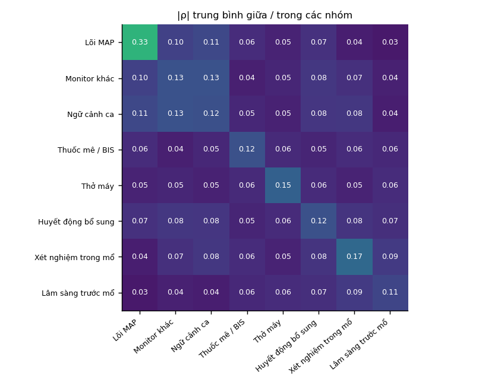
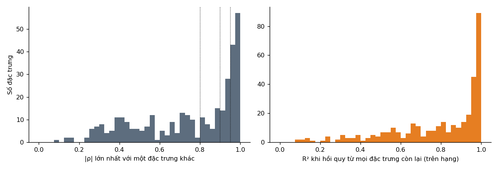
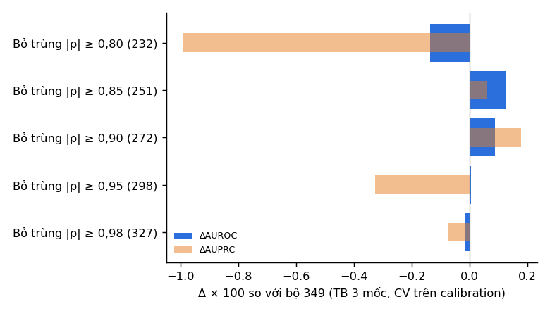

# Quan hệ giữa 349 đặc trưng của `lgbm_full_v4` (`features_v8`)

Sinh tự động từ `scripts/redundancy_v8.py` (Kaggle). W = 120 s, mốc 5 / 10 / 15 phút. Mọi thống kê và mọi lựa chọn dùng **calibration** (84.643 dòng, 258 ca; `features_v8` không có train); validation chỉ để báo cáo; test không đọc. Tương quan là Spearman theo cặp, chỉ trên các dòng cả hai cùng có giá trị (bỏ cặp có < 500 dòng chung).

## 1. Tổng quan

- Số cặp có |ρ| ≥ 0,95: **91**; ≥ 0,90: **201**; ≥ 0,80: **357** (trên 60.726 cặp).
- Số đặc trưng có ít nhất một bạn |ρ| ≥ 0,95: **100**; ≥ 0,90: 142; ≥ 0,80: 182.
- R² bội ≥ 0,99 (gần như là tổ hợp tuyến tính của các biến khác, trên hạng): **37** biến; trong đó 13 biến không có cặp nào ≥ 0,95 (trùng theo tổ hợp, không theo cặp).
- Gần hằng (giá trị phổ biến nhất ≥ 99 % số dòng có giá trị): 11 biến; thiếu ≥ 90 %: 0 biến.

Số cặp |ρ| ≥ 0,95 theo cặp nhóm:

| Nhóm A | Nhóm B | Số cặp |
|---|---|---|
| Thở máy | Thở máy | 22 |
| Huyết động bổ sung | Huyết động bổ sung | 22 |
| Thuốc mê / BIS | Thuốc mê / BIS | 18 |
| Monitor khác | Monitor khác | 9 |
| Thuốc mê / BIS | Thở máy | 5 |
| Monitor khác | Ngữ cảnh ca | 4 |
| Monitor khác | Huyết động bổ sung | 3 |
| Ngữ cảnh ca | Ngữ cảnh ca | 2 |
| Lõi MAP | Lõi MAP | 2 |
| Ngữ cảnh ca | Huyết động bổ sung | 2 |
| Xét nghiệm trong mổ | Xét nghiệm trong mổ | 1 |
| Lõi MAP | Monitor khác | 1 |

## 2. Các cặp tương quan mạnh nhất

40 cặp đầu (đủ danh sách |ρ| ≥ 0,8 trong `pairs_080.csv`, 357 cặp).

| A | B | ρ | Dòng chung |
|---|---|---|---|
| `f2_tv_age` | `f2_mv_age` | +0,999 | 84.643 |
| `f2_compliance_age` | `f2_fen2o_age` | +0,995 | 84.643 |
| `f2_pip_age` | `f2_pplat_age` | +0,995 | 84.643 |
| `f2_pplat_age` | `f2_tv_age` | +0,994 | 84.643 |
| `f2_pip_age` | `f2_tv_age` | +0,994 | 84.643 |
| `f2_pip_age` | `f2_mv_age` | +0,994 | 84.643 |
| `f2_pplat_age` | `f2_mv_age` | +0,994 | 84.643 |
| `f2_mv_age` | `f2_compliance_age` | +0,993 | 84.643 |
| `f2_nibp_sbp` | `f2_nibp_sbp_mean_m2` | +0,992 | 28.199 |
| `f2_pip_age` | `f2_compliance_age` | +0,992 | 84.643 |
| `f2_nibp_dbp` | `f2_nibp_dbp_mean_m2` | +0,992 | 28.199 |
| `f2_tv_age` | `f2_compliance_age` | +0,992 | 84.643 |
| `f2_mv_age` | `f2_fen2o_age` | +0,991 | 84.643 |
| `f2_lab_n_results` | `f1c_lab_n_abg` | +0,991 | 84.643 |
| `f2_bt` | `f2_bt_mean_m2` | +0,990 | 74.021 |
| `f2_pip_age` | `f2_fen2o_age` | +0,990 | 84.643 |
| `f2_tv_age` | `f2_fen2o_age` | +0,990 | 84.643 |
| `f2_rftn_vol_d5` | `f1c_drug_rftn_rate_mean_m5` | +0,990 | 72.584 |
| `f2_ppf_rate_mean_m15` | `f1c_drug_ppf_vol_m15` | +0,989 | 45.435 |
| `f2_ppf_vol_d5` | `f1c_drug_ppf_rate_mean_m5` | +0,989 | 46.387 |
| `f2_exp_des` | `f2_exp_des_mean_m15` | +0,989 | 19.557 |
| `f2_rftn_rate_mean_m15` | `f1c_drug_rftn_vol_m15` | +0,988 | 70.965 |
| `f2_ev_sv` | `f2_ev_sv_mean_m2` | +0,988 | 17.556 |
| `f2_pplat_age` | `f2_compliance_age` | +0,988 | 84.643 |
| `f2_ev_svi` | `f2_ev_svi_mean_m2` | +0,987 | 17.556 |
| `f2_ev_co` | `f2_ev_co_mean_m2` | +0,986 | 17.558 |
| `f1b_mac` | `f2_exp_des` | +0,985 | 19.647 |
| `f2_pplat_age` | `f2_fen2o_age` | +0,985 | 84.643 |
| `f2_ev_ci` | `f2_ev_ci_mean_m2` | +0,985 | 17.557 |
| `f2_ev_sv_d5` | `f2_ev_svi_d5` | +0,984 | 17.250 |
| `hr_mean_w120` | `f1a_hr_mean_m5` | +0,984 | 83.555 |
| `f1b_rftn` | `f2_rftn_cp_mean_m2` | +0,983 | 72.456 |
| `f2_ev_sv_sd_m5` | `f2_ev_svi_sd_m5` | +0,980 | 17.570 |
| `spo2_mean_w120` | `spo2_min_w120` | +0,980 | 84.612 |
| `sbp_missing_w120` | `pp_missing_w120` | +0,979 | 84.643 |
| `f2_pleth_hr` | `f2_pleth_hr_mean_m2` | +0,978 | 84.202 |
| `f2_mv` | `f2_mv_mean_m2` | +0,978 | 83.990 |
| `f2_compliance` | `f2_compliance_mean_m2` | +0,978 | 83.976 |
| `f2_pip` | `f2_pip_mean_m2` | +0,978 | 83.950 |
| `f1a_hr_mean_m15` | `f2_pleth_hr_mean_m15` | +0,977 | 83.253 |

## 3. Đặc trưng gần hằng hoặc thiếu nhiều

| Biến | Nhóm | Thiếu | Số giá trị khác nhau | Tỷ lệ giá trị phổ biến nhất | AUROC theo MAP (TB) |
|---|---|---|---|---|---|
| `spo2_missing_w120` | Monitor khác | 0,000 | 54 | 0,994 | 0,501 |
| `etco2_missing_w120` | Monitor khác | 0,000 | 51 | 0,993 | 0,504 |
| `f1b_position_prone` | Lâm sàng trước mổ | 0,000 | 2 | 0,997 | 0,501 |
| `f1b_position_trendelenburg` | Lâm sàng trước mổ | 0,000 | 2 | 0,997 | 0,502 |
| `f2_fen2o` | Thuốc mê / BIS | 0,008 | 1 | 1,000 | – |
| `f2_fen2o_mean_m2` | Thuốc mê / BIS | 0,007 | 1 | 1,000 | – |
| `f2_fen2o_d1` | Thuốc mê / BIS | 0,008 | 1 | 1,000 | – |
| `f2_fen2o_d5` | Thuốc mê / BIS | 0,010 | 1 | 1,000 | – |
| `f2_fen2o_sd_m5` | Thuốc mê / BIS | 0,007 | 6 | 1,000 | 0,500 |
| `f2_fen2o_mean_m15` | Thuốc mê / BIS | 0,008 | 73 | 0,999 | 0,502 |
| `f3_preop_ecg_0` | Lâm sàng trước mổ | 0,000 | 2 | 0,992 | 0,502 |

## 4. Nhóm gần trùng và biến được giữ

Nhóm: mọi cặp trong nhóm có |ρ| ≥ T (liên kết đầy đủ). Mỗi nhóm giữ một biến theo thứ tự ưu tiên: thuộc lõi MAP > |SHAP| trong mô hình 349 (CV) > AUROC trong cùng mức MAP > ít thiếu hơn. Một biến khác trong nhóm cũng được giữ khi nó có giá trị trên ≥ 5 % số dòng mà biến giữ bị thiếu (ρ theo cặp bỏ qua chỗ thiếu).

| T | Số nhóm | Biến trong nhóm | Bỏ | Giữ thêm vì phủ dòng thiếu | Còn lại |
|---|---|---|---|---|---|
| 0,98 | 18 | 40 | 22 | 0 | 327 |
| 0,95 | 40 | 93 | 51 | 2 | 298 |
| 0,90 | 46 | 127 | 77 | 4 | 272 |
| 0,85 | 49 | 152 | 98 | 5 | 251 |
| 0,80 | 50 | 173 | 117 | 6 | 232 |

Nhóm ở T = 0,85 (đủ trong `near_dup_085.csv`):

| Nhóm | Giữ | Bỏ | |ρ| nhỏ nhất |
|---|---|---|---|
| 1 | `f2_pleth_hr_mean_m15` | `hr_mean_w120`, `hr_min_w120`, `hr_current`, `f1a_hr_mean_m5`, `f1a_hr_mean_m15`, `f2_pleth_hr`, `f2_pleth_hr_mean_m2` | 0,899 |
| 2 | `f2_fen2o_age` | `f2_pip_age`, `f2_pplat_age`, `f2_tv_age`, `f2_mv_age`, `f2_compliance_age` | 0,985 |
| 3 | `f1c_drug_rftn_rate_mean_m5` | `f1b_rftn`, `f2_rftn_vol_d5`, `f2_rftn_vol_sd_m5`, `f2_rftn_cp`, `f2_rftn_cp_mean_m2` | 0,905 |
| 4 | `f2_ev_ci_mean_m15` | `f2_ev_ci`, `f2_ev_ci_mean_m2`, `f2_ev_co`, `f2_ev_co_mean_m2`, `f2_ev_co_mean_m15` | 0,893 |
| 5 | `f2_ev_svi_mean_m2` | `f2_ev_sv`, `f2_ev_sv_mean_m2`, `f2_ev_sv_mean_m15`, `f2_ev_svi`, `f2_ev_svi_mean_m15` | 0,874 |
| 6 | `f2_pplat_mean_m2` | `f2_pip`, `f2_pip_mean_m2`, `f2_pip_mean_m15`, `f2_pplat`, `f2_pplat_mean_m15` | 0,907 |
| 7 | `f1c_drug_ppf_vol_m15` | `f2_ppf_rate_mean_m15`, `f2_ppf_vol_d5`, `f2_ppf_vol_sd_m5`, `f1c_drug_ppf_rate_mean_m5` | 0,865 |
| 8 | `shock_index_current` | `shock_index_mean_w120`, `shock_index_min_w120`, `shock_index_max_w120` | 0,853 |
| 9 | `f2_exp_des`, `f1b_mac` | `f2_exp_des_sd_m5`, `f2_exp_des_mean_m15` | 0,862 |
| 10 | `rr_max_w120` | `rr_mean_w120`, `rr_min_w120`, `rr_current` | 0,890 |
| 11 | `f1a_pp_mean_m5` | `pp_mean_w120`, `pp_min_w120`, `pp_current` | 0,895 |
| 12 | `sbp_missing_w120` | `dbp_missing_w120`, `pp_missing_w120` | 0,855 |
| 13 | `f2_bis_sr_sd_m5` | `f2_bis_sr_mean_m15`, `f1c_drug_bis_sr_mean_m5` | 0,874 |
| 14 | `f2_ppf_rate_mean_m2` | `f2_ppf_rate`, `f2_ppf_vol_d1` | 0,861 |
| 15 | `f2_rftn_rate_mean_m15` | `f2_rftn_cp_mean_m15`, `f1c_drug_rftn_vol_m15` | 0,939 |
| 16 | `f2_mv_mean_m15` | `f2_mv`, `f2_mv_mean_m2` | 0,924 |
| 17 | `f2_tv_mean_m15` | `f2_tv`, `f2_tv_mean_m2` | 0,919 |
| 18 | `f2_ev_svv_mean_m15` | `f2_ev_svv`, `f2_ev_svv_mean_m2` | 0,871 |
| 19 | `f2_bt_mean_m15` | `f2_bt`, `f2_bt_mean_m2` | 0,953 |
| 20 | `map_current` | `map_mean_w120`, `map_max_w120` | 0,908 |
| 21 | `dbp_current` | `dbp_mean_w120`, `dbp_max_w120` | 0,899 |
| 22 | `f1a_map_min_m5` | `map_min_w120`, `f1a_map_mean_m5` | 0,863 |
| 23 | `f2_compliance` | `f2_compliance_mean_m2`, `f2_compliance_mean_m15` | 0,920 |
| 24 | `f1a_etco2_mean_m5` | `etco2_mean_w120`, `etco2_min_w120` | 0,915 |
| 25 | `f2_nibp_dbp_mean_m2`, `f2_nibp_dbp_mean_m15` | `f2_nibp_dbp` | 0,940 |
| 26 | `f2_nibp_sbp`, `f2_nibp_sbp_mean_m15` | `f2_nibp_sbp_mean_m2` | 0,928 |
| 27 | `sbp_current` | `sbp_mean_w120`, `sbp_max_w120` | 0,906 |
| 28 | `f1a_min_since_opstart`, `f1a_min_since_anestart`, `f2_ppf_vol` | – | 0,885 |
| 29 | `f2_exp_sevo_mean_m15` | `f2_exp_sevo` | 0,963 |
| 30 | `f1b_position_lateral` | `f1b_dept_thoracic` | 0,855 |
| 31 | `f2_bis_sr_mean_m2` | `f2_bis_sr` | 0,860 |
| 32 | `f1b_ppf` | `f2_ppf_cp` | 0,970 |
| 33 | `f2_rftn_rate_mean_m2` | `f2_rftn_vol_d1` | 0,909 |
| 34 | `f2_bis_sqi_age` | `f2_bis_sr_age` | 0,962 |
| 35 | `spo2_mean_w120` | `spo2_min_w120` | 0,980 |
| 36 | `f2_lab_po2` | `f2_lab_sao2` | 0,897 |
| 37 | `f1a_map_min_m15` | `f1a_map_min_m10` | 0,885 |
| 38 | `f1a_map_mean_m15` | `f1a_map_mean_m10` | 0,953 |
| 39 | `etco2_max_w120` | `etco2_current` | 0,925 |
| 40 | `f2_ev_svi_sd_m5` | `f2_ev_sv_sd_m5` | 0,980 |
| 41 | `f2_ev_ci_sd_m5` | `f2_ev_co_sd_m5` | 0,974 |
| 42 | `map_std_w120` | `dbp_std_w120` | 0,896 |
| 43 | `sbp_std_w120` | `pp_std_w120` | 0,853 |
| 44 | `f2_ev_sv_d5` | `f2_ev_svi_d5` | 0,984 |
| 45 | `f2_ev_co_d5` | `f2_ev_ci_d5` | 0,970 |
| 46 | `f2_ev_svi_d1` | `f2_ev_sv_d1` | 0,939 |
| 47 | `f2_ev_co_d1` | `f2_ev_ci_d1` | 0,909 |
| 48 | `sbp_slope_w120` | `map_slope_w120` | 0,904 |
| 49 | `f2_lab_n_results` | `f1c_lab_n_abg` | 0,991 |

## 5. Bỏ biến trùng có mất thông tin không (CV trên calibration)

CV 5 fold theo bệnh nhân, cùng fold với ablation; LightGBM tham số `configs/uc04_v3.json`. Quy tắc chấp nhận: ΔAUROC ≥ −0,0005 và ΔAUPRC ≥ −0,0020 (TB 3 mốc).

| Bộ | Số biến | AUROC | AUPRC | ΔAUROC | ΔAUROC 5' / 10' / 15' | ΔAUPRC | Fold xấu hơn |
|---|---|---|---|---|---|---|---|
| Tất cả 349 | 349 | 0,8223 | 0,3347 | +0,0000 | +0,0000 / +0,0000 / +0,0000 | +0,0000 | 0/5 |
| Bỏ trùng |ρ| ≥ 0,98 (327) | 327 | 0,8221 | 0,3339 | -0,0002 | -0,0003 / -0,0002 / -0,0000 | -0,0007 | 2/5 |
| Bỏ trùng |ρ| ≥ 0,95 (298) | 298 | 0,8223 | 0,3314 | +0,0000 | +0,0002 / -0,0001 / -0,0000 | -0,0033 | 3/5 |
| Bỏ trùng |ρ| ≥ 0,90 (272) | 272 | 0,8232 | 0,3364 | +0,0009 | +0,0007 / +0,0001 / +0,0019 | +0,0018 | 2/5 |
| Bỏ trùng |ρ| ≥ 0,85 (251) | 251 | 0,8235 | 0,3353 | +0,0013 | -0,0004 / +0,0019 / +0,0022 | +0,0006 | 2/5 |
| Bỏ trùng |ρ| ≥ 0,80 (232) | 232 | 0,8209 | 0,3248 | -0,0014 | -0,0039 / +0,0002 / -0,0004 | -0,0099 | 3/5 |

## 6. Validation (chỉ báo cáo)

Khác biệt so với bộ 349 là bootstrap theo bệnh nhân, ghép cặp.

Protocol `every`:

| Mô hình | Số biến | AUROC 5' | Δ 5' [CI] | AUPRC 5' | AUROC 10' | Δ 10' [CI] | AUPRC 10' | AUROC 15' | Δ 15' [CI] | AUPRC 15' |
|---|---|---|---|---|---|---|---|---|---|---|
| MAP hiện tại (luật) | 1 | 0,807 | -0,0669 [-0,0810; -0,0508] | 0,229 | 0,748 | -0,0800 [-0,0984; -0,0599] | 0,274 | 0,723 | -0,0821 [-0,1059; -0,0570] | 0,318 |
| MAP-only (lõi MAP) | 41 | 0,867 | -0,0070 [-0,0128; -0,0018] | 0,303 | 0,820 | -0,0077 [-0,0187; +0,0029] | 0,352 | 0,796 | -0,0091 [-0,0231; +0,0062] | 0,394 |
| lgbm_context (97) | 97 | 0,875 | +0,0006 [-0,0051; +0,0056] | 0,321 | 0,828 | -0,0003 [-0,0095; +0,0081] | 0,356 | 0,804 | -0,0008 [-0,0110; +0,0103] | 0,398 |
| Tất cả 349 | 349 | 0,874 | +0,0000 [+0,0000; +0,0000] | 0,296 | 0,828 | +0,0000 [+0,0000; +0,0000] | 0,347 | 0,805 | +0,0000 [+0,0000; +0,0000] | 0,405 |
| Bỏ trùng |ρ| ≥ 0,98 (327) | 327 | 0,874 | +0,0000 [-0,0010; +0,0013] | 0,296 | 0,829 | +0,0015 [-0,0010; +0,0035] | 0,352 | 0,805 | +0,0000 [-0,0022; +0,0022] | 0,405 |
| Bỏ trùng |ρ| ≥ 0,95 (298) | 298 | 0,874 | +0,0002 [-0,0012; +0,0017] | 0,296 | 0,828 | +0,0004 [-0,0019; +0,0024] | 0,351 | 0,806 | +0,0014 [-0,0018; +0,0046] | 0,411 |
| Bỏ trùng |ρ| ≥ 0,90 (272) | 272 | 0,874 | -0,0007 [-0,0022; +0,0009] | 0,292 | 0,829 | +0,0015 [-0,0015; +0,0043] | 0,352 | 0,805 | -0,0002 [-0,0034; +0,0029] | 0,405 |
| Bỏ trùng |ρ| ≥ 0,85 (251) | 251 | 0,874 | -0,0004 [-0,0024; +0,0017] | 0,295 | 0,828 | -0,0002 [-0,0034; +0,0027] | 0,349 | 0,802 | -0,0024 [-0,0056; +0,0015] | 0,400 |
| Bỏ trùng |ρ| ≥ 0,80 (232) | 232 | 0,870 | -0,0045 [-0,0070; -0,0020] | 0,280 | 0,829 | +0,0008 [-0,0026; +0,0042] | 0,352 | 0,801 | -0,0037 [-0,0079; -0,0000] | 0,399 |

Protocol `lee`:

| Mô hình | Số biến | AUROC 5' | Δ 5' [CI] | AUPRC 5' | AUROC 10' | Δ 10' [CI] | AUPRC 10' | AUROC 15' | Δ 15' [CI] | AUPRC 15' |
|---|---|---|---|---|---|---|---|---|---|---|
| MAP hiện tại (luật) | 1 | 0,848 | -0,0779 [-0,0974; -0,0614] | 0,464 | 0,818 | -0,0799 [-0,1039; -0,0590] | 0,404 | 0,817 | -0,0682 [-0,0936; -0,0422] | 0,393 |
| MAP-only (lõi MAP) | 41 | 0,919 | -0,0069 [-0,0126; -0,0008] | 0,445 | 0,894 | -0,0037 [-0,0119; +0,0073] | 0,344 | 0,884 | -0,0012 [-0,0134; +0,0107] | 0,266 |
| lgbm_context (97) | 97 | 0,926 | -0,0001 [-0,0049; +0,0045] | 0,462 | 0,902 | +0,0039 [-0,0037; +0,0135] | 0,346 | 0,891 | +0,0052 [-0,0040; +0,0148] | 0,295 |
| Tất cả 349 | 349 | 0,926 | +0,0000 [+0,0000; +0,0000] | 0,377 | 0,898 | +0,0000 [+0,0000; +0,0000] | 0,275 | 0,886 | +0,0000 [+0,0000; +0,0000] | 0,223 |
| Bỏ trùng |ρ| ≥ 0,98 (327) | 327 | 0,926 | -0,0000 [-0,0013; +0,0012] | 0,377 | 0,900 | +0,0014 [-0,0007; +0,0030] | 0,286 | 0,885 | -0,0010 [-0,0034; +0,0016] | 0,223 |
| Bỏ trùng |ρ| ≥ 0,95 (298) | 298 | 0,926 | -0,0001 [-0,0013; +0,0012] | 0,375 | 0,898 | +0,0002 [-0,0020; +0,0025] | 0,274 | 0,885 | -0,0004 [-0,0034; +0,0021] | 0,228 |
| Bỏ trùng |ρ| ≥ 0,90 (272) | 272 | 0,925 | -0,0006 [-0,0022; +0,0006] | 0,363 | 0,899 | +0,0009 [-0,0014; +0,0031] | 0,270 | 0,885 | -0,0002 [-0,0034; +0,0028] | 0,231 |
| Bỏ trùng |ρ| ≥ 0,85 (251) | 251 | 0,926 | -0,0002 [-0,0017; +0,0014] | 0,364 | 0,898 | -0,0003 [-0,0029; +0,0024] | 0,266 | 0,884 | -0,0020 [-0,0055; +0,0011] | 0,228 |
| Bỏ trùng |ρ| ≥ 0,80 (232) | 232 | 0,923 | -0,0031 [-0,0055; -0,0008] | 0,300 | 0,896 | -0,0019 [-0,0048; +0,0011] | 0,237 | 0,881 | -0,0050 [-0,0095; -0,0009] | 0,203 |

Protocol `hatib`:

| Mô hình | Số biến | AUROC 5' | Δ 5' [CI] | AUPRC 5' | AUROC 10' | Δ 10' [CI] | AUPRC 10' | AUROC 15' | Δ 15' [CI] | AUPRC 15' |
|---|---|---|---|---|---|---|---|---|---|---|
| MAP hiện tại (luật) | 1 | 0,920 | -0,0639 [-0,0830; -0,0465] | 0,965 | 0,908 | -0,0668 [-0,0860; -0,0489] | 0,956 | 0,906 | -0,0637 [-0,0868; -0,0422] | 0,953 |
| MAP-only (lõi MAP) | 41 | 0,981 | -0,0030 [-0,0081; +0,0013] | 0,991 | 0,974 | -0,0012 [-0,0092; +0,0058] | 0,987 | 0,965 | -0,0043 [-0,0145; +0,0054] | 0,983 |
| lgbm_context (97) | 97 | 0,983 | -0,0017 [-0,0059; +0,0023] | 0,992 | 0,975 | -0,0006 [-0,0067; +0,0051] | 0,988 | 0,967 | -0,0028 [-0,0098; +0,0038] | 0,983 |
| Tất cả 349 | 349 | 0,984 | +0,0000 [+0,0000; +0,0000] | 0,993 | 0,975 | +0,0000 [+0,0000; +0,0000] | 0,988 | 0,969 | +0,0000 [+0,0000; +0,0000] | 0,984 |
| Bỏ trùng |ρ| ≥ 0,98 (327) | 327 | 0,985 | +0,0005 [-0,0005; +0,0014] | 0,993 | 0,975 | +0,0004 [-0,0008; +0,0021] | 0,988 | 0,969 | -0,0001 [-0,0022; +0,0017] | 0,984 |
| Bỏ trùng |ρ| ≥ 0,95 (298) | 298 | 0,984 | -0,0004 [-0,0016; +0,0006] | 0,993 | 0,976 | +0,0005 [-0,0015; +0,0025] | 0,988 | 0,968 | -0,0011 [-0,0038; +0,0011] | 0,983 |
| Bỏ trùng |ρ| ≥ 0,90 (272) | 272 | 0,984 | -0,0001 [-0,0014; +0,0010] | 0,993 | 0,976 | +0,0011 [-0,0012; +0,0038] | 0,988 | 0,970 | +0,0007 [-0,0015; +0,0027] | 0,984 |
| Bỏ trùng |ρ| ≥ 0,85 (251) | 251 | 0,984 | -0,0003 [-0,0016; +0,0007] | 0,993 | 0,975 | -0,0002 [-0,0023; +0,0024] | 0,988 | 0,970 | +0,0006 [-0,0024; +0,0029] | 0,984 |
| Bỏ trùng |ρ| ≥ 0,80 (232) | 232 | 0,983 | -0,0013 [-0,0034; +0,0005] | 0,992 | 0,975 | -0,0003 [-0,0024; +0,0017] | 0,988 | 0,970 | +0,0008 [-0,0020; +0,0038] | 0,984 |

## 7. Đề xuất

Ngưỡng lớn nhất bước qua quy tắc CV: **|ρ| ≥ 0,85**, bỏ **98** biến, còn **251** (CV ΔAUROC +0,0013, ΔAUPRC +0,0006). Danh sách bỏ: `drop_list.csv`; bộ còn lại: `kept_columns.json`.
