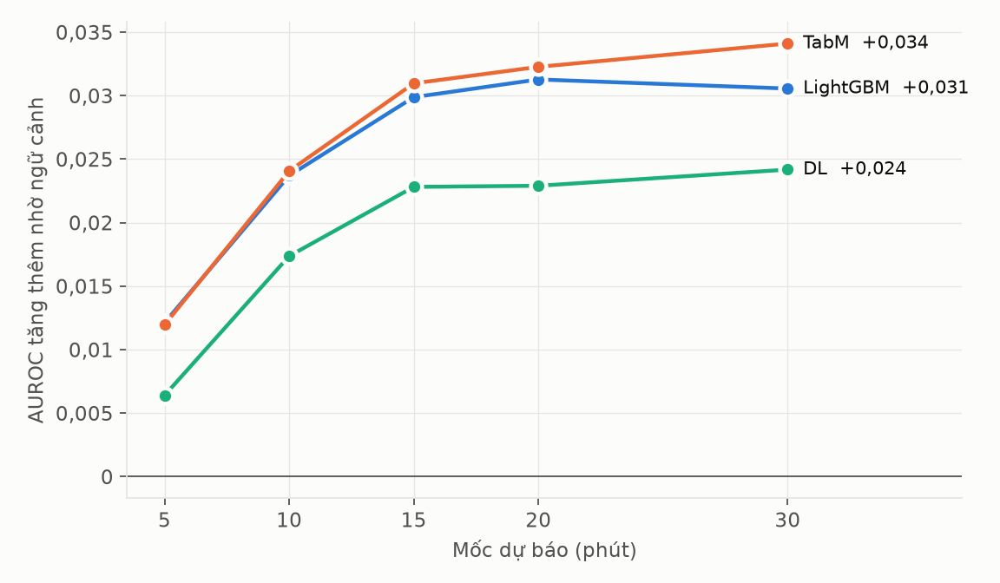
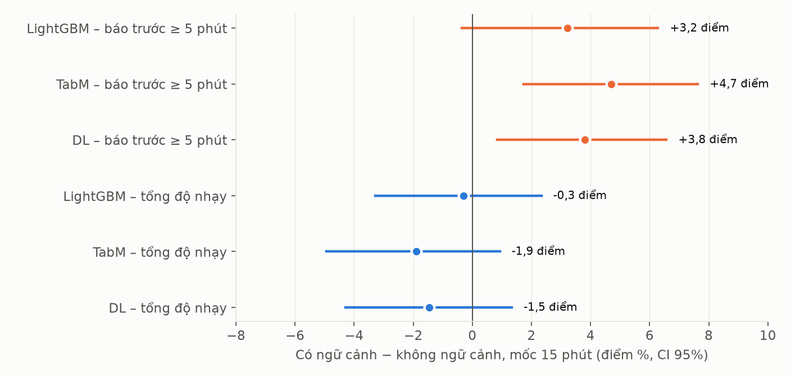
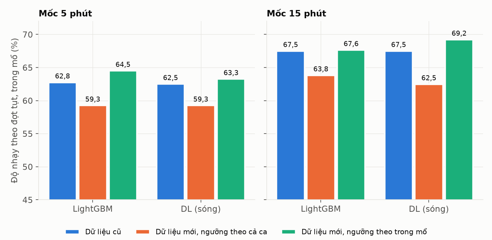

# Nghiên cứu cảnh báo sớm tụt huyết áp và rối loạn huyết động — tuần 13

## Tóm tắt

Tuần này nhóm chạy lại toàn bộ mô hình trên dữ liệu mới (có thêm giai đoạn trước rạch da). Nhóm thử thêm CatBoost, TabM và phiên bản có 31 đặc trưng ngữ cảnh của LightGBM, TabM, DL. Mỗi mô hình chạy với W = 30, 60, 90, 120 giây; DL train 5 seed cho mỗi W.

Năm mô hình dùng cùng đầu vào cho cùng một mức AUROC. Thêm ngữ cảnh làm AUROC tăng ở cả ba họ và giúp báo sớm hơn, nhưng không bắt thêm được đợt tụt. Hai mô hình tốt nhất là TabM và LightGBM có ngữ cảnh, với AUROC 0,885 ở mốc 5 phút và 0,822–0,824 ở mốc 15 phút. Khi đánh giá theo cách chọn mẫu của Hatib (2018), hai mô hình đạt AUROC 0,96–0,98, ngang hoặc cao hơn HPI.

## Daily timeline

| Ngày | Nguyễn Minh Đạt | Phạm Tuấn Anh |
|---|---|---|
| 05/10/2026 | Trao đổi về mục tiêu tuần: cải thiện dữ liệu giúp cải thiện model | Trao đổi về mục tiêu tuần |
| 06/10/2026 | Thu thập và xử lý dữ liệu mới. Huấn luyện các mô hình baseline | Huấn luyện các mô hình DL |
| 07/10/2026 | Thử nghiệm các phương pháp cải thiện độ nhạy của mô hình | Tìm kiếm phương pháp mới |
| 08/10/2026 | | Chạy lại toàn bộ mô hình trên dữ liệu mới; thêm CatBoost, TabM và các mô hình có ngữ cảnh |
| 09/10/2026 | Hoàn thiện nội dung và viết báo cáo chi tiết | Huấn luyện DL trên Kaggle; phân tích theo giai đoạn; giao diện demo |
| 10/10/2026 | | Chốt kết quả DL (5 seed × 4 cửa sổ); phân tích kết quả |

## Các mô hình

| Mô hình | Mới | Đầu vào | Cách học |
|---|:-:|---|---|
| Ngưỡng MAP | | MAP hiện tại | Báo khi MAP dưới ngưỡng |
| Hồi quy logistic | | Đặc trưng MAP | Hồi quy logistic |
| LightGBM | | 66 chỉ số | Gradient boosting trên cây quyết định |
| LightGBM + sóng | | 66 chỉ số + 27 đặc trưng sóng | Như LightGBM |
| CatBoost | ✓ | 66 chỉ số | Gradient boosting trên cây đối xứng |
| TabM | ✓ | 66 chỉ số | MLP gồm 16 mô hình con dùng chung tham số |
| DL (Conv1D + Transformer) | | Sóng động mạch 100 Hz + 66 chỉ số | Như tuần 12 |
| LightGBM, TabM, DL + ngữ cảnh | ✓ | Đầu vào gốc + 31 đặc trưng ngữ cảnh | Giữ nguyên siêu tham số |

| Mô hình | Phần cứng | Số lần train | Thời gian | Epoch tốt nhất |
|---|---|---|---|---|
| LightGBM, CatBoost | CPU | 1 lần mỗi W × mốc | khoảng 20 giây mỗi lần | – |
| TabM, TabM + ngữ cảnh | Kaggle GPU | 1 lần mỗi W | 75–98 giây | 2–3 |
| DL, DL + ngữ cảnh | Kaggle GPU T4 | 5 seed × 4 W, mỗi phiên bản | 35–100 phút mỗi seed | 0–5 |

**Ngữ cảnh** gồm 31 đặc trưng: xu hướng MAP, nhịp tim, áp lực mạch và EtCO₂ trong 5–30 phút; MAP so với trung vị của ca; thời gian từ khởi mê, từ rạch da và từ đợt tụt gần nhất; số đợt tụt đã xảy ra. Sóng động mạch chỉ có từ lúc rạch da, nên trước rạch da DL chỉ dựa vào nhánh chỉ số.

**Cách đánh giá.** Tập validation gồm 248 ca và 610 đợt tụt. Cảnh báo phát ra khi 2 mốc liên tiếp vượt ngưỡng, ngưỡng chọn sao cho có tối đa 1 cảnh báo sai mỗi giờ. Ngưỡng được chọn ngay trên validation nên số liệu có thể hơi lạc quan, và sẽ được kiểm tra lại trên tập test. Thay đổi dữ liệu so với tuần 12 ở Phụ lục D.

---

## Kết quả

### 1. Tổng hợp các mô hình

W = 120 giây, cả ca, tối đa 1 cảnh báo sai mỗi giờ.

| Mô hình | AUROC 5 phút | AUPRC 5 phút | Độ nhạy 5 phút | AUROC 15 phút | AUPRC 15 phút | Độ nhạy 15 phút | PPV 15 phút | Báo trước 15 phút |
|---|--:|--:|--:|--:|--:|--:|--:|--:|
| Ngưỡng MAP | 0,807 | 0,229 | 50,8% | 0,723 | 0,318 | 56,9% | 44,5% | 3,1 phút |
| Hồi quy logistic | 0,827 | 0,244 | 56,7% | 0,752 | 0,336 | 60,9% | 45,9% | 2,7 phút |
| LightGBM | 0,873 | 0,314 | 58,9% | 0,793 | 0,395 | 63,2% | 47,2% | 3,5 phút |
| LightGBM + sóng | 0,874 | 0,318 | 58,5% | 0,794 | 0,396 | 61,9% | 46,6% | 3,6 phút |
| CatBoost | 0,873 | 0,313 | 58,5% | 0,793 | 0,394 | **64,1%** | 47,9% | 3,7 phút |
| TabM | 0,873 | 0,302 | 58,0% | 0,793 | 0,388 | 63,8% | 47,9% | 3,4 phút |
| DL | 0,876 | 0,317 | **59,5%** | 0,798 | 0,403 | 62,9% | 47,8% | 3,6 phút |
| LightGBM + ngữ cảnh | **0,885** | 0,345 | 59,3% | 0,822 | 0,440 | 62,9% | **48,5%** | 4,2 phút |
| TabM + ngữ cảnh | **0,885** | **0,346** | 56,4% | **0,824** | **0,445** | 61,9% | 48,4% | **4,6 phút** |
| DL + ngữ cảnh | 0,882 | 0,335 | 57,2% | 0,820 | 0,443 | 61,4% | 48,2% | **4,6 phút** |

**Năm mô hình dùng cùng đầu vào cho cùng một mức kết quả.** LightGBM, LightGBM + sóng, CatBoost, TabM và DL đạt AUROC 0,873–0,876 ở mốc 5 phút và 0,793–0,798 ở mốc 15 phút, độ nhạy chênh nhau dưới 3 điểm. Cả năm đều vượt rõ hai baseline (0,807–0,827). Các cách học rất khác nhau vẫn cho cùng một kết quả, nên giới hạn nhiều khả năng nằm ở đầu vào chứ không ở thuật toán.

*Số liệu theo mọi mốc dự báo: Phụ lục A.*

### 2. Ảnh hưởng của cửa sổ W

AUROC theo W (cả ca).

| Mô hình | 5 phút, W = 30 | 60 | 90 | 120 | 15 phút, W = 30 | 60 | 90 | 120 |
|---|--:|--:|--:|--:|--:|--:|--:|--:|
| Hồi quy logistic | 0,816 | 0,824 | 0,826 | 0,827 | 0,734 | 0,744 | 0,749 | 0,752 |
| LightGBM | 0,855 | 0,866 | 0,871 | 0,873 | 0,773 | 0,783 | 0,789 | 0,793 |
| LightGBM + sóng | 0,857 | 0,867 | 0,873 | 0,874 | 0,776 | 0,785 | 0,790 | 0,794 |
| CatBoost | 0,855 | 0,866 | 0,870 | 0,873 | 0,775 | 0,784 | 0,790 | 0,793 |
| TabM | 0,854 | 0,867 | 0,871 | 0,873 | 0,773 | 0,786 | 0,789 | 0,793 |
| DL | 0,860 | 0,870 | 0,872 | 0,876 | 0,781 | 0,789 | 0,793 | 0,798 |
| LightGBM + ngữ cảnh | 0,882 | 0,885 | 0,886 | 0,885 | 0,821 | 0,822 | 0,822 | 0,822 |
| TabM + ngữ cảnh | 0,881 | 0,884 | 0,886 | 0,885 | 0,823 | 0,824 | 0,825 | 0,824 |
| DL + ngữ cảnh | 0,877 | 0,879 | 0,882 | 0,882 | 0,817 | 0,818 | 0,821 | 0,820 |

**Cửa sổ dài chỉ giúp các mô hình không có ngữ cảnh.** Tăng W từ 30 lên 120 giây làm AUROC của các mô hình này tăng 0,016–0,020, còn với mô hình có ngữ cảnh chỉ tăng 0,001–0,005. Ngữ cảnh đã chứa xu hướng MAP trong 5–30 phút, nên thay được phần lợi của cửa sổ dài. Vì vậy có thể dùng W ngắn, nhất là với DL.

### 3. DL theo seed

Gộp 5 seed, cả ca. AUROC từng seed tính trên logit chưa hiệu chỉnh.

| Mô hình | W | AUROC 5 phút, từng seed | AUROC 5 phút, gộp | AUROC 15 phút, gộp | Độ nhạy 15 phút | Báo trước 15 phút | Val loss tốt nhất |
|---|--:|--:|--:|--:|--:|--:|--:|
| DL | 30 s | 0,853–0,859 | 0,860 | 0,781 | 60,1% | 3,7 phút | 0,312–0,316 |
| DL | 120 s | 0,869–0,873 | 0,876 | 0,798 | 62,9% | 3,6 phút | 0,306–0,308 |
| DL + ngữ cảnh | 30 s | 0,870–0,876 | 0,877 | 0,817 | 60,7% | 4,4 phút | 0,297–0,298 |
| DL + ngữ cảnh | 120 s | 0,876–0,881 | 0,882 | 0,820 | 61,4% | 4,6 phút | 0,296–0,297 |

**DL ổn định giữa các seed nhưng chưa vượt các mô hình dạng bảng.** AUROC của từng seed chỉ lệch nhau 0,004–0,007, và gộp 5 seed tăng thêm tối đa 0,003. Mô hình đạt tốt nhất ở epoch 0–5, sau đó val loss tăng, tức là bắt đầu khớp quá mức. DL đạt 0,876 ở mốc 5 phút, ngang LightGBM và TabM (0,873), trong khi mỗi seed cần 35–100 phút GPU. Một phần lý do là trước rạch da chưa có sóng, nên DL chỉ dựa vào nhánh chỉ số.

### 4. Mô hình có ngữ cảnh

Không ngữ cảnh → có ngữ cảnh (W = 120 giây, cả ca).

| Họ | AUROC 5 phút | AUROC 15 phút | AUROC 30 phút | Độ nhạy 15 phút | Báo trước 15 phút | Báo trước ≥ 5 phút (15 phút) |
|---|--:|--:|--:|--:|--:|--:|
| LightGBM | 0,873 → 0,885 | 0,793 → 0,822 | 0,766 → 0,796 | 63,2% → 62,9% | 3,5 → 4,2 phút | 23,9% → 27,1% |
| TabM | 0,873 → 0,885 | 0,793 → 0,824 | 0,767 → 0,801 | 63,8% → 61,9% | 3,4 → 4,6 phút | 23,8% → 28,4% |
| DL | 0,876 → 0,882 | 0,798 → 0,820 | 0,772 → 0,796 | 62,9% → 61,4% | 3,6 → 4,6 phút | 24,3% → 28,2% |

**Ngữ cảnh làm AUROC tăng ở cả ba họ, nhiều hơn khi dự báo xa.** Mức tăng là 0,006–0,012 ở mốc 5 phút và 0,024–0,034 ở mốc 30 phút; với LightGBM, khoảng tin cậy 95% của mức tăng không chứa 0. Bốn đặc trưng quan trọng nhất của LightGBM ở mốc 15 phút đều là MAP thấp nhất trong 5–30 phút qua. Dự báo gần chỉ cần MAP hiện tại, còn dự báo xa cần biết huyết áp đã xuống thấp tới đâu trong nửa giờ qua.

**Ở mức cảnh báo, ngữ cảnh giúp báo sớm hơn nhưng không bắt thêm được đợt tụt.** Ở mốc 15 phút, thời gian báo trước tăng thêm khoảng 1 phút và tỷ lệ đợt được báo trước ít nhất 5 phút tăng 3–5 điểm, còn tổng độ nhạy gần như không đổi. Ngữ cảnh giúp nhiều nhất khi MAP còn bình thường, trong khi cảnh báo chủ yếu phát ra lúc MAP đã thấp. Vì vậy đợt tụt được báo sớm hơn chứ không được bắt nhiều hơn.

*Số liệu chi tiết: Phụ lục B, C.*

---

## So sánh với các nghiên cứu khác

**Hai mô hình tốt nhất là TabM + ngữ cảnh và LightGBM + ngữ cảnh.** Cả hai đạt AUROC 0,885 ở mốc 5 phút. TabM có AUROC ở mốc 15 phút cao nhất (0,824) và báo sớm nhất (4,6 phút). LightGBM có PPV cao nhất (48,5%), train trong vài chục giây trên CPU và giải thích được từng dự báo bằng TreeSHAP.

**Các phương pháp đã công bố.**

| Nghiên cứu | Dữ liệu | Đầu vào | Phương pháp | Mốc dự báo | AUROC | Cách chọn mẫu |
|---|---|---|---|---|--:|---|
| Hatib et al., 2018 (HPI) [1] | Dữ liệu riêng | Sóng huyết áp động mạch | Học máy trên hàng nghìn đặc trưng sóng | 5 / 10 / 15 phút | 0,97 / 0,95 / 0,95 | Đoạn tụt và đoạn ổn định được chọn trước |
| Lee et al., 2021 [2] | VitalDB, 3.301 ca | Sóng động mạch (thêm ECG, PPG, EtCO₂) | CNN | 15 phút | 0,891 (đa kênh 0,897) | Phân loại đoạn tụt và đoạn không tụt |
| Jo et al., 2022 [4] | VitalDB, 14.140 ca | Sóng động mạch + EEG | Học sâu | 5 phút | 0,935 | Chưa kiểm tra |
| Kapral et al., 2024 [5] | 73.009 ca (Vienna); kiểm định ngoài trên VitalDB | Sinh hiệu độ phân giải thấp + thuốc | Temporal Fusion Transformer dự báo giá trị MAP | Đến 7 phút | 0,933 (nội bộ); 0,919 (VitalDB) | Dự báo MAP liên tục rồi phân loại MAP < 65 |
| Kendale et al., 2018 [6] | Dữ liệu riêng | Thông tin trước mổ và thuốc khởi mê | Gradient boosting | 10 phút sau khởi mê | 0,76 | Bài toán khác: MAP < 55 sau khởi mê |
| Tổng hợp 2024 [7] | 43 nghiên cứu | Nhiều loại | HPI / mô hình học máy khác | Nhiều mốc | 0,89 / 0,79 (gộp) | Nhiều cách |
| **LightGBM + ngữ cảnh (nhóm)** | VitalDB, validation 248 ca | 66 chỉ số + 31 đặc trưng ngữ cảnh | LightGBM | 5 / 10 / 15 phút | 0,885 / 0,844 / 0,822 | Mọi thời điểm, 30 giây một lần |
| **TabM + ngữ cảnh (nhóm)** | VitalDB, validation 248 ca | 66 chỉ số + 31 đặc trưng ngữ cảnh | TabM | 5 / 10 / 15 phút | 0,885 / 0,845 / 0,824 | Mọi thời điểm, 30 giây một lần |

**Các nghiên cứu khác nhau nhiều về dữ liệu, mốc dự báo và cách chọn mẫu, nên con số AUROC không so trực tiếp được với nhau.** Phần lớn báo cáo AUROC từ 0,89 đến 0,97, cao hơn mức 0,82–0,885 của nhóm. Tuy nhiên, các bài này đánh giá trên các đoạn được chọn trước hoặc trên bài toán dự báo giá trị MAP, còn nhóm dự đoán ở mọi thời điểm. Kapral (2024) gần với cách làm của nhóm nhất vì dự báo liên tục và có kiểm định ngoài trên VitalDB, nhưng nhãn của bài này là MAP < 65 tại một thời điểm, không phải một đợt tụt mới bắt đầu. Vì vậy, nhóm chỉ so trực tiếp với HPI, bằng cách dựng lại đúng cách chọn mẫu của Hatib trên dữ liệu của nhóm.

**Đánh giá lại theo cách của Hatib (2018).** Mô hình giữ nguyên, chỉ đổi cách chọn mẫu trên tập validation. Mẫu dương là mốc dự đoán nằm đúng 5, 10, 15 phút trước khi một đợt tụt bắt đầu. Mẫu âm là điểm giữa của các đoạn 30 phút có MAP luôn trên 75 mmHg và cách mọi đợt tụt ít nhất 20 phút. Tập này gồm 403–430 mẫu dương và 368 mẫu âm, mọi mô hình dùng chung một tập mẫu. "Chỉ MAP hiện tại" là quy tắc đơn giản nhất: MAP càng thấp thì nguy cơ càng cao.

| Mô hình | Theo Hatib, 5 phút | 10 phút | 15 phút | Mọi thời điểm, 5 phút | 15 phút |
|---|--:|--:|--:|--:|--:|
| HPI (Hatib et al., 2018) [1] | 0,97 | 0,95 | 0,95 | – | – |
| Chỉ MAP hiện tại | 0,878 | 0,868 | 0,863 | 0,807 | 0,723 |
| Hồi quy logistic | 0,900 | 0,905 | 0,900 | 0,827 | 0,752 |
| LightGBM | 0,957 | 0,933 | 0,931 | 0,873 | 0,793 |
| TabM | 0,959 | 0,932 | 0,929 | 0,873 | 0,793 |
| DL | 0,961 | 0,940 | 0,933 | 0,876 | 0,798 |
| **LightGBM + ngữ cảnh** | **0,977** | **0,974** | **0,967** | 0,885 | 0,822 |
| **TabM + ngữ cảnh** | **0,977** | 0,970 | 0,962 | 0,885 | 0,824 |
| DL + ngữ cảnh | 0,973 | 0,966 | 0,959 | 0,882 | 0,820 |

**Khi đánh giá theo cách của Hatib, hai mô hình tốt nhất đạt hoặc vượt AUROC của HPI.** LightGBM + ngữ cảnh đạt 0,977, 0,974 và 0,967 ở mốc 5, 10 và 15 phút, còn TabM + ngữ cảnh đạt 0,977, 0,970 và 0,962, so với 0,97, 0,95 và 0,95 của HPI. Ở mốc 15 phút, khoảng tin cậy 95% của LightGBM + ngữ cảnh là 0,953–0,978. Các mô hình không có ngữ cảnh đạt 0,93–0,96, ngang hoặc thấp hơn HPI một chút. Như vậy, khoảng cách giữa 0,82 và 0,95 trước đây chủ yếu đến từ cách chọn mẫu chứ không phải từ mô hình. HPI được train và kiểm định trên dữ liệu khác, nên đây vẫn là so sánh gián tiếp.

**Cách chọn mẫu của Hatib làm AUROC cao lên rõ, kể cả với quy tắc chỉ dùng MAP.** Chỉ dùng MAP hiện tại, AUROC tăng từ 0,807 lên 0,878 ở mốc 5 phút và từ 0,723 lên 0,863 ở mốc 15 phút. Nguyên nhân là mẫu âm luôn có MAP trên 75 mmHg (trung vị 93), còn mẫu dương có MAP trung vị 69–71 và chỉ 24–29% trên 75. Hai nhóm vì vậy gần như tách nhau theo MAP hiện tại, đúng như Enevoldsen và Vistisen (2022) [3] đã chỉ ra. Vùng khó nhất, khi MAP ở 65–75 mmHg nhưng chưa tụt, bị loại khỏi tập mẫu âm. Vì vậy nhóm vẫn dùng cách đánh giá ở mọi thời điểm làm kết quả chính, còn kết quả theo Hatib chỉ dùng để so sánh với các nghiên cứu khác.

Với Lee (2021) và Jo (2022), nhóm chưa có toàn văn nên chưa dựng lại được cách chọn mẫu, và các con số này chỉ dùng để tham khảo.

*Số liệu và khoảng tin cậy của mọi mô hình: `reports/weekly/week13/hatib_protocol.csv`.*

---

## Lựa chọn phương pháp

Nhóm lấy ý tưởng chính của từng phương pháp đã công bố và thử nhanh trên dữ liệu của nhóm. Mô hình gốc là LightGBM + ngữ cảnh (W = 120 giây), mỗi lần chỉ thêm một ý tưởng, cùng tập train và validation.

| Ý tưởng | Lấy từ | AUROC 5 phút | AUROC 15 phút | AUPRC 15 phút | Theo Hatib, 15 phút | Quyết định |
|---|---|--:|--:|--:|--:|---|
| Mô hình gốc: LightGBM + ngữ cảnh | Nhóm | 0,885 | 0,822 | 0,440 | 0,967 | Giữ |
| Đặc trưng hình dạng sóng | HPI [1] | 0,874* | 0,794* | 0,396* | 0,926* | Bỏ |
| Học sâu đọc sóng thô | Lee [2], Jo [4] | 0,876* | 0,798* | 0,403* | 0,933* | Bỏ |
| + thuốc mê, BIS, thông tin trước mổ | Jo [4], Kapral [5], Kendale [6] | 0,888 | 0,829 | 0,453 | 0,971 | Dùng |
| + thông khí, thuốc, xét nghiệm | Kapral [5] | **0,889** | **0,830** | 0,454 | 0,972 | Dùng |
| Dự báo MAP thấp nhất trong h phút tới | Kapral [5] | 0,859 | 0,816 | 0,441 | 0,966 | Bỏ |
| Trộn với dự báo MAP | Kapral [5] | 0,881 | 0,828 | **0,455** | **0,975** | Bỏ |
| Trung bình LightGBM, TabM, DL | STEP-OP | 0,887 | 0,826 | 0,451 | 0,965 | Chưa dùng |

\* Mô hình không có ngữ cảnh, lấy từ kết quả chính ở trên.

**Thêm thông tin lâm sàng có giúp, nhưng ít hơn nhiều so với ngữ cảnh.** Thêm thuốc mê, BIS và thông tin trước mổ làm AUROC ở mốc 15 phút tăng từ 0,822 lên 0,829; thêm thông khí và xét nghiệm lên 0,830. Mức tăng này chỉ khoảng 0,008, so với 0,030 khi thêm ngữ cảnh. Thuốc mê và BIS phản ánh độ sâu gây mê, một nguyên nhân trực tiếp của tụt huyết áp mà sinh hiệu chưa thể hiện ngay.

**Dự báo giá trị MAP và kết hợp nhiều mô hình gần như không giúp.** Mô hình dự báo MAP thấp nhất trong h phút tới, theo cách của Kapral, đạt AUROC thấp hơn mô hình phân loại (0,816 so với 0,822). Trộn hai mô hình cũng không vượt mô hình có thêm thông tin lâm sàng. Lấy trung bình LightGBM, TabM và DL chỉ tăng 0,002–0,004, trong khi chi phí chạy tăng gấp ba. Đây là kết quả của một lần chạy, chưa có khoảng tin cậy.

**Hướng phương pháp mới: cảnh báo theo ngữ cảnh và theo giai đoạn.** Các phương pháp đã công bố chủ yếu cải thiện cách đọc tín hiệu tại thời điểm hiện tại. Kết quả của nhóm cho thấy hướng này đã bão hòa: năm thuật toán, kể cả học sâu đọc sóng, đều dừng ở cùng một mức. Phần giúp nhiều nhất là thông tin về quá khứ của ca, còn yếu tố quyết định độ nhạy là giai đoạn trước rạch da và quy tắc cảnh báo. Vì vậy, phương pháp đề xuất gồm bốn phần. Đầu vào gồm chỉ số monitor, ngữ cảnh của ca, thuốc mê, BIS, thông khí và xét nghiệm. Mô hình là LightGBM, vì nhanh và giải thích được bằng TreeSHAP. Quy tắc cảnh báo được chọn riêng cho trước rạch da và trong mổ. Mô hình được đánh giá ở mọi thời điểm, ở mức cảnh báo, và theo cách của Hatib để so sánh với các nghiên cứu khác.

*Số liệu: `reports/weekly/week13/pilot_methods.csv`.*

---

## Kết luận

Đổi thuật toán không làm mô hình tốt hơn. Năm mô hình dùng cùng đầu vào cho cùng một mức AUROC, và DL không vượt LightGBM dù tốn nhiều thời gian train hơn.

Ngữ cảnh là thay đổi đầu tiên làm mô hình tốt lên, nhiều nhất khi dự báo xa, và làm W gần như không còn ảnh hưởng. Ở mức cảnh báo, ngữ cảnh giúp báo sớm hơn nhưng độ nhạy vẫn khoảng 56–64%. Độ nhạy phụ thuộc vào quy tắc cảnh báo và giai đoạn trước rạch da nhiều hơn là vào mô hình (Phụ lục E, J).

Hai mô hình tốt nhất là TabM và LightGBM có ngữ cảnh. Khi đánh giá theo cách chọn mẫu của Hatib, hai mô hình đạt AUROC 0,96–0,98, ngang hoặc cao hơn HPI. Cách chọn mẫu này cũng làm AUROC của quy tắc chỉ dùng MAP tăng từ 0,72–0,81 lên 0,86–0,88, nên không phản ánh đúng hiệu năng khi dùng thực tế.

Trong các ý tưởng lấy từ phương pháp đã công bố, chỉ có thông tin lâm sàng (thuốc mê, BIS, thông khí, xét nghiệm) giúp thêm, với AUROC ở mốc 15 phút tăng từ 0,822 lên 0,830. Phương pháp đề xuất vì vậy dựa trên ngữ cảnh của ca, thông tin lâm sàng và quy tắc cảnh báo riêng cho từng giai đoạn.

## Hướng tiếp theo

Tuần tới nhóm sẽ xây dựng phương pháp đề xuất: LightGBM với ngữ cảnh và thông tin lâm sàng, kèm quy tắc cảnh báo riêng cho từng giai đoạn. Nhóm sẽ chạy đủ 5 mốc dự báo với khoảng tin cậy bootstrap, và đo độ nhạy ở mức cảnh báo. Nhóm cũng sẽ tìm toàn văn của Lee (2021) để đánh giá lại theo cách chọn mẫu của bài này. Sau khi chốt mốc dự báo và quy tắc cảnh báo, nhóm sẽ mở tập test và đánh giá một lần duy nhất.

## Tài liệu tham khảo

1. Hatib F, et al. Machine-learning algorithm to predict hypotension based on high-fidelity arterial pressure waveform analysis. *Anesthesiology* 2018. https://pubmed.ncbi.nlm.nih.gov/29894315/
2. Lee S, et al. Deep learning models for the prediction of intraoperative hypotension. *Br J Anaesth* 2021;126(4):808–817. https://pubmed.ncbi.nlm.nih.gov/33558051/
3. Enevoldsen J, Vistisen ST. Performance of the Hypotension Prediction Index may be overestimated due to selection bias. *Anesthesiology* 2022;137(3):283–289. https://asa2.silverchair.com/anesthesiology/article-pdf/137/3/283/674583/20220900.0-00009.pdf
4. Jo YY, et al. Predicting intraoperative hypotension using deep learning with waveforms of arterial blood pressure, electroencephalogram, and electrocardiogram: retrospective study. *PLoS ONE* 2022;17(8):e0272055. https://doi.org/10.1371/journal.pone.0272055
5. Kapral L, et al. Development and external validation of temporal fusion transformer models for continuous intraoperative blood pressure forecasting. *eClinicalMedicine* 2024;75:102797. https://doi.org/10.1016/j.eclinm.2024.102797
6. Kendale S, et al. Supervised machine-learning predictive analytics for prediction of postinduction hypotension. *Anesthesiology* 2018;129:675–688. https://pubmed.ncbi.nlm.nih.gov/30074930/
7. Predictive ability of hypotension prediction index and machine learning methods in intraoperative hypotension: a systematic review and meta-analysis. *J Transl Med* 2024. https://www.ncbi.nlm.nih.gov/pmc/articles/PMC11302102/

---

## Phụ lục

### A. Tất cả mô hình trên dữ liệu mới theo mốc dự báo (W = 120, cả ca)

Mỗi ô: AUROC · độ nhạy theo đợt tụt (≤ 1 báo sai/giờ trên cả ca).

| Mô hình | 5 phút | 10 phút | 15 phút | 20 phút | 30 phút |
|---|--:|--:|--:|--:|--:|
| Ngưỡng MAP | 0,807 · 50,8% | 0,748 · 53,1% | 0,723 · 56,9% | 0,714 · 57,6% | 0,706 · 61,7% |
| Hồi quy logistic | 0,827 · 56,7% | 0,774 · 61,6% | 0,752 · 60,9% | 0,744 · 64,5% | 0,737 · 67,2% |
| LightGBM | 0,873 · 58,9% | 0,820 · 62,7% | 0,793 · 63,2% | 0,780 · 64,5% | 0,766 · 64,5% |
| LightGBM + sóng | 0,874 · 58,5% | 0,822 · 62,3% | 0,794 · 61,9% | 0,782 · 62,0% | 0,769 · 65,0% |
| CatBoost | 0,873 · 58,5% | 0,820 · 64,4% | 0,793 · 64,1% | 0,782 · 65,2% | 0,767 · 65,1% |
| TabM | 0,873 · 58,0% | 0,821 · 63,8% | 0,793 · 63,8% | 0,782 · 65,3% | 0,767 · 66,2% |
| DL | 0,876 · 59,5% | 0,825 · 62,3% | 0,798 · 62,9% | 0,786 · 63,9% | 0,772 · 66,2% |
| LightGBM + ngữ cảnh | 0,885 · 59,3% | 0,844 · 63,2% | 0,822 · 62,9% | 0,811 · 64,2% | 0,796 · 65,7% |
| TabM + ngữ cảnh | 0,885 · 56,4% | 0,845 · 61,0% | 0,824 · 61,9% | 0,814 · 63,7% | 0,801 · 66,2% |
| DL + ngữ cảnh | 0,882 · 57,2% | 0,843 · 61,0% | 0,820 · 61,4% | 0,809 · 62,0% | 0,796 · 65,4% |

Mỗi ô: PPV · thời gian báo trước trung vị · số báo sai/giờ.

| Mô hình | 5 phút | 10 phút | 15 phút | 20 phút | 30 phút |
|---|--:|--:|--:|--:|--:|
| Ngưỡng MAP | 32,4% · 1,6 ph · 0,92 | 42,6% · 2,3 ph · 0,79 | 44,5% · 3,1 ph · 0,95 | 52,4% · 3,7 ph · 0,82 | 58,2% · 5,3 ph · 0,90 |
| Hồi quy logistic | 33,0% · 1,5 ph · 1,00 | 40,8% · 2,3 ph · 1,00 | 45,9% · 2,7 ph · 0,95 | 51,0% · 3,4 ph · 0,97 | 58,7% · 5,1 ph · 0,99 |
| LightGBM | 34,0% · 1,5 ph · 0,99 | 42,2% · 2,8 ph · 0,99 | 47,2% · 3,5 ph · 0,99 | 51,3% · 4,1 ph · 1,00 | 58,7% · 5,3 ph · 0,97 |
| LightGBM + sóng | 35,2% · 1,6 ph · 0,93 | 41,9% · 2,7 ph · 0,99 | 46,6% · 3,6 ph · 0,99 | 51,7% · 4,5 ph · 0,97 | 58,4% · 5,7 ph · 1,00 |
| CatBoost | 35,3% · 1,5 ph · 0,93 | 43,0% · 2,8 ph · 0,98 | 47,9% · 3,7 ph · 0,99 | 52,5% · 4,2 ph · 0,98 | 58,4% · 5,5 ph · 0,98 |
| TabM | 34,1% · 1,6 ph · 0,97 | 42,7% · 2,9 ph · 0,99 | 47,9% · 3,4 ph · 0,98 | 52,6% · 4,1 ph · 0,99 | 59,7% · 5,5 ph · 0,98 |
| DL | 35,9% · 1,7 ph · 0,92 | 43,3% · 3,0 ph · 0,96 | 47,8% · 3,6 ph · 0,97 | 52,3% · 4,4 ph · 0,97 | 59,6% · 6,2 ph · 0,99 |
| LightGBM + ngữ cảnh | 35,8% · 1,7 ph · 0,92 | 42,7% · 3,3 ph · 0,98 | 48,5% · 4,2 ph · 0,94 | 52,8% · 5,8 ph · 0,98 | 59,1% · 8,1 ph · 1,00 |
| TabM + ngữ cảnh | 33,8% · 1,8 ph · 0,96 | 42,6% · 3,3 ph · 0,96 | 48,4% · 4,6 ph · 0,96 | 53,6% · 5,8 ph · 0,97 | 59,8% · 8,0 ph · 0,99 |
| DL + ngữ cảnh | 33,2% · 1,7 ph · 1,00 | 42,1% · 3,6 ph · 1,00 | 48,2% · 4,6 ph · 0,98 | 53,1% · 5,8 ph · 0,99 | 59,3% · 7,6 ph · 1,00 |

### B. Mức tăng nhờ ngữ cảnh

AUROC (W = 120, cả ca), không ngữ cảnh → có ngữ cảnh:

| Họ mô hình | 5 phút | 10 phút | 15 phút | 20 phút | 30 phút |
|---|--:|--:|--:|--:|--:|
| LightGBM | 0,873 → 0,885 (+0,012) | 0,820 → 0,844 (+0,024) | 0,793 → 0,822 (+0,030) | 0,780 → 0,811 (+0,031) | 0,766 → 0,796 (+0,031) |
| TabM | 0,873 → 0,885 (+0,012) | 0,821 → 0,845 (+0,024) | 0,793 → 0,824 (+0,031) | 0,782 → 0,814 (+0,032) | 0,767 → 0,801 (+0,034) |
| DL | 0,876 → 0,882 (+0,006) | 0,825 → 0,843 (+0,017) | 0,798 → 0,820 (+0,023) | 0,786 → 0,809 (+0,023) | 0,772 → 0,796 (+0,024) |

AUROC theo MAP hiện tại và theo giai đoạn, cùng tỷ lệ đợt được báo trước ≥ 5 phút (không ngữ cảnh → có ngữ cảnh):

| Mốc | Họ | MAP < 75 | MAP ≥ 75 | Trước rạch da | Trong mổ | Báo trước ≥ 5 phút |
|---|--:|--:|--:|--:|--:|--:|
| 5 phút | LightGBM | 0,772 → 0,794 | 0,817 → 0,838 | 0,820 → 0,837 | 0,873 → 0,884 | 0,2% → 0,2% |
| 5 phút | TabM | 0,768 → 0,792 | 0,817 → 0,837 | 0,823 → 0,837 | 0,873 → 0,884 | 0,2% → 0,2% |
| 5 phút | DL | 0,775 → 0,786 | 0,822 → 0,831 | 0,818 → 0,830 | 0,875 → 0,881 | 0,0% → 0,2% |
| 10 phút | LightGBM | 0,715 → 0,742 | 0,775 → 0,818 | 0,758 → 0,787 | 0,817 → 0,842 | 17,0% → 19,9% |
| 10 phút | TabM | 0,716 → 0,749 | 0,776 → 0,818 | 0,761 → 0,787 | 0,819 → 0,843 | 17,8% → 19,6% |
| 10 phút | DL | 0,723 → 0,743 | 0,783 → 0,813 | 0,757 → 0,785 | 0,822 → 0,841 | 19,0% → 20,4% |
| 15 phút | LightGBM | 0,684 → 0,714 | 0,750 → 0,804 | 0,732 → 0,758 | 0,789 → 0,822 | 23,9% → 27,1% |
| 15 phút | TabM | 0,686 → 0,726 | 0,749 → 0,802 | 0,733 → 0,758 | 0,790 → 0,823 | 23,8% → 28,4% |
| 15 phút | DL | 0,691 → 0,717 | 0,758 → 0,795 | 0,727 → 0,758 | 0,793 → 0,818 | 24,3% → 28,2% |

| Mốc | Số mốc MAP < 75 | Tỷ lệ dương | Số mốc MAP ≥ 75 | Tỷ lệ dương |
|---|--:|--:|--:|--:|
| 5 phút | 19.239 | 14,9% | 65.294 | 1,9% |
| 10 phút | 18.425 | 23,7% | 62.066 | 5,1% |
| 15 phút | 17.788 | 30,6% | 59.196 | 8,3% |

10 đặc trưng quan trọng nhất của LightGBM + ngữ cảnh (theo gain, W = 120). Đặc trưng ngữ cảnh in đậm. 31 đặc trưng ngữ cảnh chiếm 39,3% tổng gain ở mốc 5 phút và 73,3% ở mốc 15 phút.

| # | Mốc 5 phút | Tỷ trọng | Mốc 15 phút | Tỷ trọng |
|---|--:|--:|--:|--:|
| 1 | map_current | 37,1% | **f1a_map_min_m10** | 16,9% |
| 2 | **f1a_map_min_m5** | 10,5% | **f1a_map_min_m5** | 15,1% |
| 3 | map_extrap_w120 | 9,8% | **f1a_map_min_m15** | 12,0% |
| 4 | **f1a_map_min_m15** | 5,8% | **f1a_map_min_m30** | 9,0% |
| 5 | **f1a_map_min_m30** | 5,3% | map_extrap_w120 | 6,4% |
| 6 | dbp_current | 5,2% | map_current | 5,6% |
| 7 | **f1a_map_min_m10** | 4,7% | dbp_current | 4,8% |
| 8 | **f1a_min_since_last_event** | 3,0% | **f1a_min_since_last_event** | 4,8% |
| 9 | **f1a_min_since_opstart** | 1,8% | dbp_min_w120 | 4,5% |
| 10 | **f1a_n_prev_events** | 1,6% | **f1a_min_since_opstart** | 3,1% |

### C. Ngữ cảnh ở mức cảnh báo

Bootstrap ghép cặp theo bệnh nhân, 1.000 lần, ngưỡng theo cả ca:

| Mốc | Họ | Chỉ số | Không ngữ cảnh | Có ngữ cảnh | Chênh lệch (điểm) | CI 95% |
|---|--:|--:|--:|--:|--:|--:|
| 10 phút | LightGBM | Báo trước ≥ 5 phút | 17,0% | 19,9% | +2,9 | [+0,0; +5,5] |
| 10 phút | LightGBM | Tổng độ nhạy | 62,7% | 63,2% | +0,5 | [-2,3; +2,9] |
| 10 phút | TabM | Báo trước ≥ 5 phút | 17,8% | 19,6% | +1,8 | [-1,1; +4,4] |
| 10 phút | TabM | Tổng độ nhạy | 63,8% | 61,0% | -2,7 | [-6,2; +0,0] |
| 10 phút | DL | Báo trước ≥ 5 phút | 19,0% | 20,4% | +1,4 | [-1,3; +4,0] |
| 10 phút | DL | Tổng độ nhạy | 62,3% | 61,0% | -1,2 | [-4,5; +1,5] |
| 15 phút | LightGBM | Báo trước ≥ 5 phút | 23,9% | 27,1% | +3,2 | [-0,4; +6,3] |
| 15 phút | LightGBM | Tổng độ nhạy | 63,2% | 62,9% | -0,3 | [-3,3; +2,3] |
| 15 phút | TabM | Báo trước ≥ 5 phút | 23,8% | 28,4% | +4,7 | [+1,7; +7,6] |
| 15 phút | TabM | Tổng độ nhạy | 63,8% | 61,9% | -1,9 | [-4,9; +0,9] |
| 15 phút | DL | Báo trước ≥ 5 phút | 24,3% | 28,2% | +3,8 | [+0,8; +6,6] |
| 15 phút | DL | Tổng độ nhạy | 62,9% | 61,4% | -1,5 | [-4,3; +1,3] |

### D. Thay đổi dữ liệu so với tuần 12

**Dữ liệu.** Tuần 12 chỉ dùng dữ liệu từ lúc rạch da. Tuần này mỗi ca được thêm trung vị 41,5 phút trước rạch da, trong đó 30,1 phút có huyết áp động mạch. Giai đoạn này chỉ chiếm 15% số giờ nhưng chứa 37% số đợt tụt.

| | Tuần 12 | Tuần 13 | Thay đổi |
|---|--:|--:|--:|
| Số giờ đánh giá | 6.214 | 7.147 | +15% |
| Mốc dự đoán | 747.762 | 859.706 | +15% |
| Đợt tụt huyết áp | 4.922 | 7.474 | +52% |

Ngoài ra, mô hình có thêm dữ liệu lâm sàng, nâng số đặc trưng từ 66 lên 349.

| Nhóm | Số đặc trưng | Nội dung |
|---|--:|---|
| Tín hiệu mới theo thời gian | 169 | 25 tín hiệu: thông khí, thuốc mê bơm và khí mê, BIS, nhiệt độ, huyết áp băng quấn, cung lượng tim (EV1000/Vigileo); mỗi tín hiệu có tối đa 7 con số tóm tắt |
| Xét nghiệm trong ca | 14 | 11 chỉ số khí máu và điện giải gần nhất, thời gian từ lần lấy mẫu, số kết quả |
| Thông tin không đổi trong ca | 52 | Tuổi, giới, BMI, ASA, bệnh nền, loại phẫu thuật, tư thế, xét nghiệm trước mổ |
| Ngữ cảnh và tín hiệu gốc mở rộng | 48 | Cửa sổ quan sát tới 30 phút, nồng độ đích thuốc mê, lịch sử của ca |

### E. Kết quả theo giai đoạn

W = 120 giây. Độ nhạy là độ nhạy trong mổ, với hai cách chọn ngưỡng: tối đa 1 cảnh báo sai mỗi giờ tính trên cả ca, hoặc chỉ tính trong mổ.

| Mô hình | AUROC 5 phút, trước rạch da | AUROC 5 phút, trong mổ | AUROC 15 phút, trước rạch da | AUROC 15 phút, trong mổ | Độ nhạy 5 phút, ngưỡng cả ca | Độ nhạy 5 phút, ngưỡng trong mổ |
|---|--:|--:|--:|--:|--:|--:|
| LightGBM (tuần 12) | – | 0,874 | – | 0,790 | 62,8% | 62,8% |
| DL (tuần 12) | – | 0,873 | – | 0,791 | 62,5% | 62,5% |
| LightGBM | 0,820 | 0,873 | 0,732 | 0,789 | 59,3% | 64,5% |
| CatBoost | 0,817 | 0,873 | 0,733 | 0,790 | – | – |
| TabM | 0,823 | 0,873 | 0,733 | 0,790 | 57,3% | 64,3% |
| DL | 0,818 | 0,875 | 0,727 | 0,793 | 59,3% | 63,3% |
| LightGBM + ngữ cảnh | 0,837 | 0,884 | 0,758 | 0,822 | 58,5% | 64,3% |
| TabM + ngữ cảnh | 0,837 | 0,884 | 0,758 | 0,823 | 53,3% | 60,0% |
| DL + ngữ cảnh | 0,830 | 0,881 | 0,758 | 0,818 | 55,8% | 61,3% |

**Mọi mô hình đều dự báo kém hơn ở giai đoạn trước rạch da so với trong mổ.** Ở mốc 5 phút, AUROC trước rạch da của năm mô hình học máy không có ngữ cảnh chỉ đạt 0,817–0,823, trong khi trong mổ là 0,873–0,875. Ở mốc 15 phút, khoảng cách vẫn khoảng 0,06. DL không có lợi thế ở giai đoạn này vì dữ liệu sóng chỉ bắt đầu từ lúc rạch da. Nguyên nhân là trước rạch da, MAP hiện tại phản ánh nguy cơ kém hơn. Cùng một mức MAP, tỷ lệ có tụt huyết áp trong 5 phút tới ở giai đoạn này cao hơn trong mổ từ 1,4 đến 7,6 lần, do tác dụng của thuốc mê liều đầu và thở máy chưa thể hiện ngay trên MAP. Ngữ cảnh thu hẹp được một phần khoảng cách, với AUROC trước rạch da tăng lên 0,830–0,837 ở mốc 5 phút và 0,758 ở mốc 15 phút.

**Độ nhạy thấp hơn tuần 12 là do cách chọn ngưỡng, không phải do mô hình kém đi.** Trong mổ, AUROC của LightGBM gần như giữ nguyên so với tuần 12 (0,874 và 0,873). Khi chọn ngưỡng theo cả ca, độ nhạy trong mổ của LightGBM ở mốc 5 phút giảm từ 62,8% xuống 59,3%. Khi chọn ngưỡng theo cảnh báo sai trong mổ, con số này tăng lên 64,5%, cao hơn tuần 12. Nguyên nhân là ở giai đoạn trước rạch da, các mô hình tạo ra 2,0–2,7 cảnh báo sai mỗi giờ. Để trung bình cả ca không vượt quá 1 cảnh báo sai mỗi giờ, ngưỡng phải nâng lên, nên trong mổ chỉ còn 0,70–0,85 cảnh báo sai mỗi giờ và mô hình bắt được ít đợt tụt hơn. Dùng hai ngưỡng riêng cho hai giai đoạn mà vẫn giữ giới hạn chung cho cả ca cũng gần như không cải thiện.

*Số liệu chi tiết: Phụ lục F, G, H, I.*

### F. Nguy cơ theo MAP hiện tại và giai đoạn

Tỷ lệ mốc dự đoán có đợt tụt mới trong h phút tới (validation, chỉ các mốc đủ điều kiện).

| Mốc | MAP (mmHg) | Trước rạch da | Số mốc | Trong mổ | Số mốc | Gấp |
|---|--:|--:|--:|--:|--:|--:|
| 5 phút | <70 | 32,2% | 1.700 | 22,7% | 6.095 | 1,4× |
| 5 phút | 70–75 | 14,3% | 1.886 | 7,0% | 9.558 | 2,1× |
| 5 phút | 75–80 | 7,6% | 1.873 | 2,7% | 11.886 | 2,8× |
| 5 phút | 80–90 | 4,9% | 2.660 | 1,3% | 22.493 | 3,6× |
| 5 phút | ≥90 | 5,5% | 2.627 | 0,7% | 23.755 | 7,6× |
| 15 phút | <70 | 49,9% | 1.664 | 39,1% | 5.678 | 1,3× |
| 15 phút | 70–75 | 30,7% | 1.785 | 21,3% | 8.661 | 1,4× |
| 15 phút | 75–80 | 24,3% | 1.762 | 11,2% | 10.681 | 2,2× |
| 15 phút | 80–90 | 18,8% | 2.476 | 6,9% | 20.331 | 2,7× |
| 15 phút | ≥90 | 19,4% | 2.448 | 4,2% | 21.498 | 4,6× |

Theo số đợt tụt đã xảy ra trong ca (mốc 5 phút):

| MAP (mmHg) | 0 đợt | 1 đợt | 2 đợt | ≥ 3 đợt |
|---|--:|--:|--:|--:|
| <70 | 20,8% | 23,9% | 20,4% | 29,3% |
| 70–75 | 8,2% | 6,8% | 6,8% | 9,4% |
| 75–80 | 3,9% | 2,7% | 2,1% | 4,1% |
| 80–90 | 1,9% | 1,3% | 1,4% | 2,2% |
| ≥90 | 1,2% | 1,2% | 1,1% | 1,3% |

Quy mô từng giai đoạn ở mốc 5 phút:

| Giai đoạn | Số đợt tụt | Số giờ | Tỷ lệ mốc dương | AUROC LightGBM |
|---|--:|--:|--:|--:|
| cả ca | 610 | 704,4 | 4,8% | 0,873 |
| trước rạch da | 210 | 89,5 | 11,5% | 0,820 |
| trong mổ | 400 | 614,9 | 3,9% | 0,873 |

### G. Độ nhạy theo cách chọn ngưỡng

W = 120 giây. Ngưỡng chọn trên validation, sao cho cảnh báo sai ≤ 1/giờ tính trên cả ca hoặc chỉ trong mổ. Dữ liệu cũ chỉ có giai đoạn trong mổ, nên hai cách cho cùng kết quả.

| Mốc | Dữ liệu | Mô hình | Ngưỡng theo | Độ nhạy trong mổ | Báo sai/giờ trong mổ | Báo sai/giờ trước rạch da | Báo sai/giờ cả ca | Độ nhạy cả ca |
|---|--:|--:|--:|--:|--:|--:|--:|--:|
| 5 phút | cũ | LightGBM | – | 62,8% | 0,96 | – | 0,96 | 62,8% |
| 5 phút | cũ | DL | – | 62,5% | 0,97 | – | 0,97 | 62,5% |
| 5 phút | mới | LightGBM | cả ca | 59,3% | 0,83 | 2,01 | 0,98 | 58,4% |
| 5 phút | mới | LightGBM | trong mổ | 64,5% | 0,97 | 2,37 | 1,15 | 62,8% |
| 5 phút | mới | LightGBM + ngữ cảnh | cả ca | 58,5% | 0,74 | 2,52 | 0,96 | 59,7% |
| 5 phút | mới | LightGBM + ngữ cảnh | trong mổ | 64,3% | 0,98 | 3,24 | 1,27 | 65,1% |
| 5 phút | mới | TabM | cả ca | 57,3% | 0,80 | 2,10 | 0,96 | 57,7% |
| 5 phút | mới | TabM | trong mổ | 64,3% | 0,99 | 2,55 | 1,19 | 63,4% |
| 5 phút | mới | TabM + ngữ cảnh | cả ca | 53,3% | 0,71 | 2,62 | 0,95 | 56,2% |
| 5 phút | mới | TabM + ngữ cảnh | trong mổ | 60,0% | 0,96 | 3,28 | 1,26 | 61,6% |
| 5 phút | mới | DL | cả ca | 59,3% | 0,76 | 2,60 | 1,00 | 60,3% |
| 5 phút | mới | DL | trong mổ | 63,3% | 0,99 | 3,27 | 1,28 | 63,9% |
| 5 phút | mới | DL + ngữ cảnh | cả ca | 55,8% | 0,73 | 2,69 | 0,98 | 56,7% |
| 5 phút | mới | DL + ngữ cảnh | trong mổ | 61,3% | 0,99 | 3,48 | 1,30 | 62,3% |
| 15 phút | cũ | LightGBM | – | 67,5% | 0,98 | – | 0,98 | 67,5% |
| 15 phút | cũ | DL | – | 67,5% | 0,98 | – | 0,98 | 67,5% |
| 15 phút | mới | LightGBM | cả ca | 63,8% | 0,83 | 2,01 | 0,99 | 63,0% |
| 15 phút | mới | LightGBM | trong mổ | 67,6% | 0,94 | 2,45 | 1,14 | 66,0% |
| 15 phút | mới | LightGBM + ngữ cảnh | cả ca | 61,6% | 0,77 | 2,45 | 0,99 | 62,9% |
| 15 phút | mới | LightGBM + ngữ cảnh | trong mổ | 67,4% | 0,99 | 3,22 | 1,28 | 67,4% |
| 15 phút | mới | TabM | cả ca | 64,7% | 0,85 | 1,98 | 1,00 | 63,8% |
| 15 phút | mới | TabM | trong mổ | 67,6% | 0,94 | 2,19 | 1,11 | 65,8% |
| 15 phút | mới | TabM + ngữ cảnh | cả ca | 61,3% | 0,75 | 2,39 | 0,97 | 62,5% |
| 15 phút | mới | TabM + ngữ cảnh | trong mổ | 66,3% | 0,95 | 2,97 | 1,21 | 66,0% |
| 15 phút | mới | DL | cả ca | 62,5% | 0,70 | 2,68 | 0,96 | 62,8% |
| 15 phút | mới | DL | trong mổ | 69,2% | 0,99 | 3,69 | 1,34 | 68,6% |
| 15 phút | mới | DL + ngữ cảnh | cả ca | 60,4% | 0,76 | 2,44 | 0,98 | 61,3% |
| 15 phút | mới | DL + ngữ cảnh | trong mổ | 65,8% | 0,98 | 3,04 | 1,25 | 65,7% |

### H. Dữ liệu cũ và mới theo giai đoạn (W = 120, ngưỡng theo cả ca)

| Mốc | Mô hình | AUROC cũ | AUROC mới, trong mổ | AUROC mới, trước rạch da | Độ nhạy cũ | Độ nhạy mới, trong mổ | Độ nhạy mới, trước rạch da | Độ nhạy mới, cả ca | Báo sai/giờ cũ | Báo sai/giờ mới, trong mổ | Báo sai/giờ mới, trước rạch da |
|---|--:|--:|--:|--:|--:|--:|--:|--:|--:|--:|--:|
| 5 phút | Ngưỡng MAP | 0,828 | 0,828 | 0,730 | 56,0% | 56,0% | 41,0% | 50,8% | 0,83 | 0,82 | 1,61 |
| 5 phút | Hồi quy logistic | 0,839 | 0,841 | 0,756 | 62,3% | 58,3% | 53,8% | 56,7% | 0,98 | 0,85 | 2,01 |
| 5 phút | LightGBM | 0,874 | 0,873 | 0,820 | 62,8% | 60,0% | 56,7% | 58,9% | 0,93 | 0,84 | 2,02 |
| 5 phút | LightGBM + sóng | 0,875 | 0,874 | 0,821 | 63,5% | 58,8% | 58,1% | 58,5% | 0,99 | 0,79 | 1,88 |
| 5 phút | DL | 0,873 | 0,875 | 0,818 | 62,5% | 58,0% | 62,4% | 59,5% | 0,96 | 0,69 | 2,47 |
| 10 phút | Ngưỡng MAP | 0,767 | 0,767 | 0,665 | 62,2% | 58,1% | 43,9% | 53,1% | 0,94 | 0,71 | 1,38 |
| 10 phút | Hồi quy logistic | 0,780 | 0,783 | 0,700 | 66,9% | 63,0% | 59,1% | 61,6% | 0,99 | 0,83 | 2,15 |
| 10 phút | LightGBM | 0,817 | 0,817 | 0,758 | 68,6% | 64,4% | 59,6% | 62,7% | 0,98 | 0,83 | 2,07 |
| 10 phút | LightGBM + sóng | 0,820 | 0,819 | 0,761 | 68,6% | 63,5% | 60,0% | 62,3% | 0,99 | 0,82 | 2,16 |
| 10 phút | DL | 0,820 | 0,822 | 0,757 | 67,4% | 61,6% | 63,5% | 62,3% | 0,99 | 0,71 | 2,64 |
| 15 phút | Ngưỡng MAP | 0,739 | 0,739 | 0,642 | 61,1% | 61,6% | 48,1% | 56,9% | 0,88 | 0,87 | 1,49 |
| 15 phút | Hồi quy logistic | 0,755 | 0,757 | 0,686 | 65,0% | 61,3% | 59,9% | 60,9% | 0,95 | 0,79 | 2,01 |
| 15 phút | LightGBM | 0,790 | 0,789 | 0,732 | 67,5% | 64,0% | 61,6% | 63,2% | 0,99 | 0,84 | 2,01 |
| 15 phút | LightGBM + sóng | 0,791 | 0,790 | 0,736 | 66,1% | 62,7% | 60,3% | 61,9% | 0,99 | 0,84 | 2,02 |
| 15 phút | DL | 0,791 | 0,793 | 0,727 | 67,5% | 62,5% | 63,7% | 62,9% | 0,98 | 0,71 | 2,68 |

### I. Thử hai ngưỡng riêng theo giai đoạn (kết quả âm tính, W = 120, cả ca)

Ngưỡng chọn trên tập calibration rồi kiểm tra trên validation: một ngưỡng chung so với hai ngưỡng riêng cho trước rạch da và trong mổ.

| Mốc | Mô hình | Độ nhạy, 1 ngưỡng | Báo sai/giờ | Độ nhạy, 2 ngưỡng | Báo sai/giờ |
|---|--:|--:|--:|--:|--:|
| 5 phút | CatBoost | 55,2% | 0,88 | 57,0% | 0,91 |
| 10 phút | CatBoost | 63,0% | 0,93 | 64,2% | 0,97 |
| 5 phút | LightGBM + ngữ cảnh | 59,3% | 0,92 | 59,5% | 0,93 |
| 10 phút | LightGBM + ngữ cảnh | 63,0% | 0,99 | 63,3% | 0,98 |
| 5 phút | LightGBM | 55,1% | 0,87 | 56,2% | 0,91 |
| 10 phút | LightGBM | 60,9% | 0,93 | 60,3% | 0,99 |
| 5 phút | LightGBM + sóng | 56,9% | 0,90 | 57,9% | 0,92 |
| 10 phút | LightGBM + sóng | 60,7% | 0,94 | 59,8% | 0,95 |
| 5 phút | Hồi quy logistic | 54,4% | 0,93 | 55,1% | 0,96 |
| 10 phút | Hồi quy logistic | 61,2% | 0,97 | 61,0% | 0,96 |

### J. LightGBM 349 đặc trưng và quy tắc cảnh báo

**Với mô hình 349 đặc trưng, quy tắc cảnh báo ảnh hưởng tới độ nhạy nhiều hơn chính mô hình.** LightGBM 349 đặc trưng đạt AUROC 0,841 ở mốc 15 phút, cao hơn 0,797 của mô hình 66 đặc trưng, nhưng với quy tắc cũ độ nhạy chỉ đạt 61,2%. Khi đổi từ "2 mốc liên tiếp, tối đa 1 cảnh báo sai mỗi giờ" sang "1 mốc, tối đa 2 cảnh báo sai mỗi giờ", độ nhạy tăng 15–17 điểm và PPV giảm 6–7 điểm. Ở mốc 15 phút, độ nhạy tăng lên 77,8%, PPV giảm từ 48,3% xuống 41,1%, và thời gian báo trước trung vị là 5,5 phút. Mức thay đổi này lớn hơn nhiều so với khác biệt giữa các mô hình, vốn dưới 3 điểm. Lý do là quy tắc nới rộng cho phép mô hình cảnh báo nhiều hơn, nên bắt được nhiều đợt tụt hơn nhưng cũng báo sai nhiều hơn, với khoảng 3 trong 5 cảnh báo là cảnh báo sai.

#### LightGBM 349 đặc trưng (mốc 15 phút, W = 120 giây, 2 mốc, ≤ 1 cảnh báo sai mỗi giờ)

| Chỉ số | Mô hình ban đầu (66 đặc trưng, trong mổ) | Mô hình mới (349 đặc trưng, cả ca) |
|---|--:|--:|
| Độ nhạy theo đợt tụt [CI 95%] | 65,9% [64,1; 67,7] | 61,2% [59,8; 62,5] |
| Cảnh báo sai/giờ | 0,92 | 0,97 |
| PPV | 44,8% | 48,3% |
| Báo trước, trung vị [Q1–Q3] | 4,0 [1,4–8,9] phút | 4,6 [1,8–9,3] phút |
| AUROC [CI 95%] | 0,797 [0,787; 0,805] | 0,841 [0,835; 0,848] |
| AUPRC [CI 95%] | 0,367 [0,348; 0,388] | 0,475 [0,459; 0,490] |

Nếu chỉ xét trong mổ, mô hình mới đạt độ nhạy 65,9%, AUPRC 0,433, PPV 44,0%.

Bảng này được đánh giá trên tập lớn hơn (6.559 đợt tụt eligible), còn các phần ở trên dùng tập validation 248 ca. Vì vậy không so trực tiếp từng con số giữa hai phần được.

#### Đổi quy tắc cảnh báo (LightGBM 349 đặc trưng)

| Mốc dự báo | Quy tắc | Báo sai tối đa/giờ | Độ nhạy [CI 95%] | PPV | Báo trước, trung vị [Q1–Q3] |
|---|---|--:|--:|--:|--:|
| 10 phút | 2 mốc | 1 | 61,2% [59,8; 62,5] | 43,0% | 3,3 [1,4–6,0] phút |
| 10 phút | 1 mốc | 2 | 78,2% [77,1; 79,3] | 37,0% | 3,9 [1,7–6,5] phút |
| 15 phút | 2 mốc | 1 | 61,2% [59,8; 62,6] | 48,3% | 4,6 [1,8–9,3] phút |
| 15 phút | 1 mốc | 2 | 77,8% [76,7; 78,9] | 41,1% | 5,5 [2,1–10,3] phút |
| 20 phút | 2 mốc | 1 | 62,8% [61,4; 64,2] | 52,6% | 6,0 [2,2–12,5] phút |
| 20 phút | 1 mốc | 2 | 77,5% [76,3; 78,7] | 45,5% | 6,9 [2,5–13,7] phút |

### K. Dữ liệu và code

- Số liệu của các biểu đồ: `reports/weekly/week13/*.csv`.
- Bảng so sánh đầy đủ 10 mô hình × 4 W × 5 mốc × 3 giai đoạn: `reports/version_comparison_final.csv` trên HF `tuananhpham-vnu/uc04-v3-runs`.
- Giao diện demo chạy cục bộ: `deploy/`. Gồm trang dự báo từ file CSV, phát lại ca mẫu, và giải thích từng dự báo bằng TreeSHAP.
